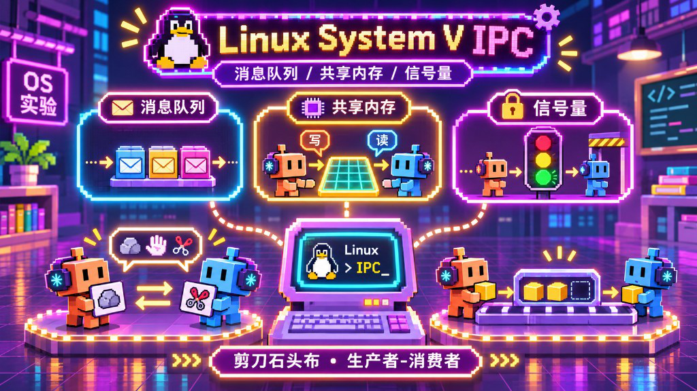

On November 15 I was working through an OS lab. The assignment asks for rock-paper-scissors over Linux IPC, a producer-consumer program with semaphores, and a networked version. While doing the lab, I also wanted to understand Linux process communication: what the three System V mechanisms are for, how to create and use them, and how rock-paper-scissors can be written with them.

Processes created with `fork()` each have their own address space. A variable in one process is invisible to the other. To exchange data, they need a kernel channel. System V IPC is the set of interfaces that comes up first in this lab.


{caption="Message queues, shared memory, and semaphores, with rock-paper-scissors and producer-consumer"}

## Why IPC Is Needed {#why-ipc}

Separate address spaces protect processes, and they also break casual sharing. A parent cannot tell a child “scissors this round” through an ordinary global variable; each side only sees its own copy.

IPC leaves a place in the kernel that both sides can touch: a queue of messages, one physical memory region, or a semaphore that only counts and blocks. Rock-paper-scissors in this lab is exactly that problem: take turns, then read the other player's move.

## Three System V Mechanisms {#sysv-three}

Classic System V IPC has three main tools: message queues, semaphore sets, and shared memory segments. None is simply “better.” They trade convenience against speed.

### Message Queues {#msg-queue-idea}

A message queue moves bounded blocks of data. A process packs a typed message and leaves it with the kernel; the receiver can pull messages by type.

The gain is **decoupling and order**. The sender does not wait for the receiver to be ready; messages line up in the kernel. The receiver can pick only the types it cares about. The cost is a copy into the kernel and another copy out, so this path is usually the slowest of the three.

For a little discrete control traffic, such as exchanging one move per round, a message queue is often enough: a few lines of code, and the kernel handles queuing, blocking, and type filters.

### Semaphores {#sem-idea}

A semaphore itself **carries no business data**. It keeps an integer that means “how many resources are free” or “whether the gate is open.” Processes change that value with `semop`; if there is nothing left, the kernel puts the caller to sleep.

Its core is a **counter plus a wait queue**, used to order access to a shared resource. If the goal is only “at most two processes may write the log,” a semaphore is enough. There is no need to reserve a large memory region for that.

### Shared Memory {#shm-idea}

Shared memory is a physical region the kernel carves out. Processes map it into their own address spaces with `shmat`. One process writes, the other sees it at once, with **no kernel copy** of the payload, so this path is usually the fastest.

Speed comes with no built-in sync. If two processes write the same location at once, the data breaks. Shared memory needs a semaphore, or some other lock you provide.

When throughput is high and latency matters, the copy cost of a message queue becomes hard to accept. Then shared memory pulls the speed up, and semaphores keep the read and write order under control.

## Using Message Queues {#msg-api}

Think of the kernel side as a list of typed messages. Processes append nodes or remove a node of a chosen type.

| Function | Role |
| --- | --- |
| `msgget` | Create a queue, or get the id of an existing one |
| `msgsnd` | Append one message |
| `msgrcv` | Remove one message |

The important field is `mtype`. `msgrcv` can ask for one type only. For example, `mtype=1` can mean player A's move and `mtype=2` player B's, so neither side reads the message it just sent.

If the wanted type is missing and `IPC_NOWAIT` is not set, the caller sleeps until a matching message appears, a signal arrives, or the queue is deleted.

### Creating a Queue and Choosing a Key {#msgget}

```c
int msqid = msgget(key, msgflg);
```

`key` tells the OS which IPC object you mean. Related processes often write:

```c
int msqid = msgget(IPC_PRIVATE, IPC_CREAT | 0600);
```

`IPC_PRIVATE` always creates a new object instead of looking up an existing one. `IPC_CREAT` is the create flag, and `0600` is the permission.

The flow is: the parent creates the queue, keeps `msqid`, then calls `fork()`. The child inherits that id, and both sides use the same queue. The child does not create another queue and does not look one up by key.

Unrelated programs do not inherit `msqid`. They can agree on an ordinary key, or build one with `ftok()` from a path and a project id. `ftok()` is not guaranteed unique, so collisions still matter in practice.

### Message Layout and Send / Receive {#msgsnd-msgrcv}

System V requires the first field of the message struct to be a `long` message type, and the value must be positive when sending. The kernel does not know your other members; it only reads that leading `long` by convention:

```c
struct Message {
    long mtype;
    int round;
    int move;
};
```

On send, `msgsz` is the body length and **does not** include `mtype`:

```c
msgsnd(msqid, msg, sizeof(struct Message) - sizeof(long), 0);
```

`msgflg` of `0` means the default: the sender may block if the queue is full.

Receive adds `msgtyp`, which chooses the type:

| `msgtyp` | Meaning |
| --- | --- |
| `0` | First message in the queue, any type |
| `> 0` | First message whose type equals that value |
| `< 0` | Among messages whose type is at most the absolute value, the one with the smallest type |

Negative `msgtyp` exists so a receiver can take higher-priority types first, instead of always following send order. Urgent, normal, and low-priority work can use different `mtype` values.

### What Happens When a Signal Interrupts {#eintr}

While blocked in `msgsnd` or `msgrcv`, the process is not spinning. The kernel parks it on a wait queue and runs other ready work. A matching message means the original wait condition is met. A signal means a new event needs a response now.

A signal handler is still code of that same process. If the process is blocked, the kernel must wake it first so it can run the handler. After the handler returns, the original call often comes back as `-1` with `errno` set to `EINTR`, meaning the call was interrupted before it finished.

The usual pattern is to retry on `EINTR` and fail on other errors:

```c
while (msgsnd(...) == -1) {
    if (errno == EINTR)
        continue;
    perror("msgsnd");
    return -1;
}
```

### Delete the Queue When Done {#msg-rm}

```c
msgctl(msqid, IPC_RMID, NULL);
```

Message queues live in the kernel. They do not vanish when the parent exits. Leaving them behind leaks IPC resources.

## Using Shared Memory {#shm-api}

`shmget` creates or looks up a shared segment. It returns an id `shmid`, not a usable pointer yet:

```c
int shmid = shmget(IPC_PRIVATE,
                   sizeof(struct SharedData),
                   IPC_CREAT | 0600);
```

Every process has its own virtual address space. After the kernel owns the segment, `shmat` maps it into the current process so you get a pointer:

```c
struct SharedData *shared = shmat(shmid, NULL, 0);
```

Mapping failure returns `(void *)-1`. If the parent maps before `fork()`, the child inherits that mapping. The calls can also happen after `fork()`, with each side attaching the same `shmid`.

Detach with `shmdt`, then remove the segment with `shmctl(..., IPC_RMID, ...)`.

## Using Semaphores {#sem-api}

### Create and Initialize {#semget}

```c
int semid = semget(IPC_PRIVATE, 2, IPC_CREAT | 0600);
```

The `2` means the set holds two semaphores. After the parent creates it, the child inherits `semid` through `fork()`.

Initial values come from `semctl`. `SETVAL` sets one semaphore by index; the argument is often passed through `union semun`:

```c
union semun {
    int val;
    struct semid_ds *buf;
    unsigned short *array;
};

union semun arg;
arg.val = 0;
semctl(semid, 0, SETVAL, arg);
semctl(semid, 1, SETVAL, arg);
```

### P and V {#pv}

The real work is `semop`. One operation is described by `struct sembuf`: which semaphore, how much to add or subtract, and which flags.

I wrap the common add and subtract as `sem_change`, then as P and V:

```c
int sem_change(int semid, unsigned short num, short op)
{
    struct sembuf sb = {num, op, 0};

    while (semop(semid, &sb, 1) == -1) {
        if (errno == EINTR)
            continue;
        perror("semop");
        return -1;
    }
    return 0;
}

int P(int semid, unsigned short num)
{
    return sem_change(semid, num, -1);
}

int V(int semid, unsigned short num)
{
    return sem_change(semid, num, 1);
}
```

The kernel value must not go negative under a P. When there is no resource left, the process waits instead of driving `semval` below zero.

### Textbook Negatives and Linux Wait Queues {#sem-negative}

Textbooks often record waiting processes as a negative semaphore value. Linux System V does not need that: the kernel keeps its own wait queue. So **0 is legal, and negatives are not**. Both descriptions talk about the same sync idea; they bookkeep differently.

## Two Designs for Rock-Paper-Scissors {#rps}

From an engineering angle, a message queue is the clearer fit: send a move, receive the other move, then score. Shared memory plus semaphores exercises both the shared table and the traffic light. I planned both.

### Message Queue {#rps-msg}

The parent creates the queue, then `fork()`. The parent is player A: each round it draws a move and sends it. The child is player B: after reading A's move, it draws its own and sends it back. The parent scores the round. After several rounds it prints the totals and deletes the queue.

No extra semaphore is required here. Blocking in `msgsnd` and `msgrcv` already means “read after the other side has written.” Different `mtype` values keep each side from reading its own message.

### Shared Memory Plus Semaphores {#rps-shm}

The shared segment holds both moves and the round number. Two semaphores guard the two directions:

- After A writes, wake B to read
- After B writes, wake A to read

Without those semaphores, shared memory is only bare storage both sides can touch, and the timing of reads and writes can still collide.

## Review {#review}

This pass folds System V IPC into three lines:

1. Message queues fit small bounded control messages, and the type field can filter them.
2. Shared memory is fastest, but you must handle sync yourself.
3. Semaphores do not carry payload; they only count and wait. On Linux the waiters live in a kernel wait queue, not in a negative counter.

Rock-paper-scissors can sync with a message queue alone, or with shared memory plus two direction semaphores.
