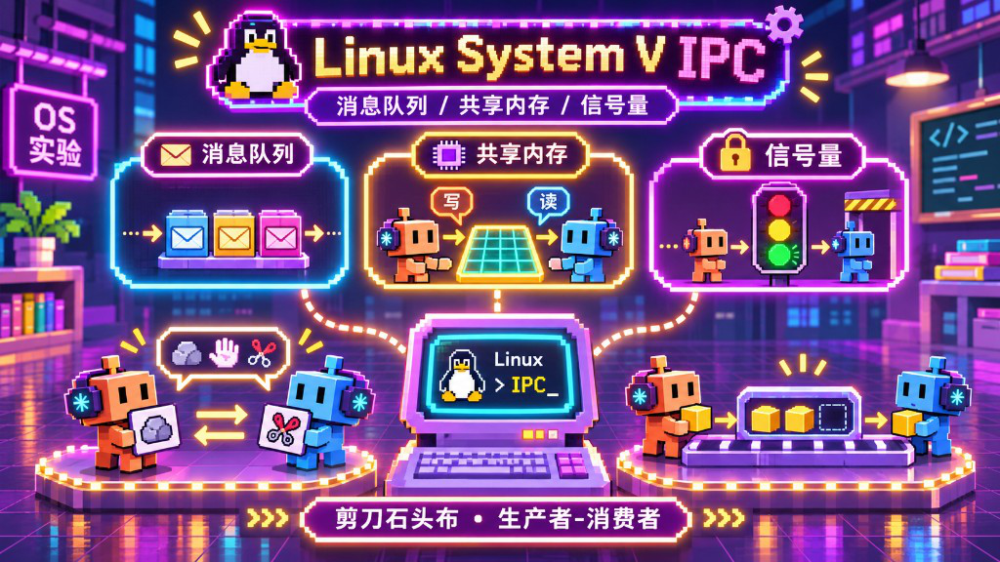

11月15日我在做操作系统实验。题目要求用 Linux IPC 做剪刀石头布，再用信号量做生产者-消费者，并改成能在网络上跑。做这道实验的同时，我也想把 Linux 里的进程通信弄清楚：System V 三类机制各自管什么，消息队列、共享内存和信号量怎么建、怎么用，以及剪刀石头布可以怎么写。

`fork()` 出来的进程各有地址空间，一个进程里的变量另一个看不到。要交换数据，只能借内核提供的公共通道。System V IPC 就是这类通道里最常碰到的一组接口。


{caption="消息队列、共享内存、信号量，以及剪刀石头布和生产者-消费者"}

## 为什么需要 IPC {#why-ipc}

独立地址空间保护了进程，也把协作拆开了。父进程想告诉子进程“这轮出剪刀”，不能指望共享一个普通全局变量，因为两边看到的是各自的副本。

IPC 的作用，就是在内核里留一块双方都能碰到的地方：可以是排队的消息，可以是同一段物理内存，也可以是只负责计数和阻塞的信号量。实验里的剪刀石头布，要解决的就是双方轮流出拳、读到对方结果这件事。

## System V 的三类机制 {#sysv-three}

经典 System V IPC 主要有三类：消息队列、信号量集合、共享内存段。它们不是谁更高级，而是在“传得省心”和“传得快”之间做不同取舍。

### 消息队列 {#msg-queue-idea}

消息队列传的是有边界的数据块。进程把数据打成一条带类型标签的消息，交给内核保管；接收方可以按类型取走。

它的价值是 **解耦与有序**。发送方不用管对方什么时候来拿，消息在内核里排队；接收方也能只挑自己关心的类型。代价是数据要先拷进内核，再拷出用户空间，三类里通常最慢。

少量、离散的控制信息，比如一局游戏交换一次出拳，消息队列往往最合适：写几行就能用，内核帮你排队、阻塞、按类型筛选。

### 信号量 {#sem-idea}

信号量本身 **不传业务数据**。它只维护一个整数值，表示“现在有几个资源可用”或“门是否开着”。进程通过 `semop` 加减这个值来申请或释放；资源不够时，内核让进程睡眠等待。

它的本质是 **计数器加等待队列**，专门协调多个进程访问共享资源的顺序。如果只想限制“最多两个进程同时写日志”，用信号量就够，不必为此占一大块内存。

### 共享内存 {#shm-idea}

共享内存是内核划出一块物理区域，多个进程用 `shmat` 把它映射进自己的地址空间。一个进程往里写，另一个立刻能看到，中间 **没有内核拷贝**，所以通常最快。

快的代价是“裸奔”：内核不会帮你同步。两个进程同时写同一块内存，数据就会乱。共享内存必须配合信号量，或者自己实现的锁。

吞吐量很大、对延迟敏感时，消息队列的拷贝开销会很难忍，这时才需要共享内存把速度拉满，再用信号量把读写顺序管住。

## 消息队列怎么用 {#msg-api}

内核里维护的可以想成一条链表，每个节点是带类型标签的消息。进程往里放节点，或者按类型取走节点。

| 函数 | 作用 |
| --- | --- |
| `msgget` | 创建新队列，或拿到已有队列的 ID |
| `msgsnd` | 把一条消息加到队列末尾 |
| `msgrcv` | 从队列取走一条消息 |

关键字段是 `mtype`。`msgrcv` 可以指定只收某种类型。例如 `mtype=1` 表示玩家 A 的出拳，`mtype=2` 表示玩家 B 的出拳，双方就不会读到自己刚发出去的那条。

如果队列里暂时没有指定类型的消息，又没有设 `IPC_NOWAIT`，调用进程会睡眠，直到消息出现、进程收到信号，或者队列被删掉。

### 创建与 key {#msgget}

```c
int msqid = msgget(key, msgflg);
```

`key` 告诉操作系统你想创建或访问哪一个 IPC 对象。父子进程常这样写：

```c
int msqid = msgget(IPC_PRIVATE, IPC_CREAT | 0600);
```

`IPC_PRIVATE` 表示总是新建一个对象，不查找、不复用已有对象。`IPC_CREAT` 是创建标志，`0600` 是权限。

流程是：父进程创建队列，拿到 `msqid`，再 `fork()`。子进程继承这个标识符，双方共用同一条队列。子进程不必再创建，也不必靠 key 去找。

如果不是父子关系，就没有继承的 `msqid`。两边可以约定同一个普通 key，或用 `ftok()` 从路径和项目标识生成 key。`ftok()` 不能保证绝对唯一，实际还要考虑冲突。

### 消息结构与收发 {#msgsnd-msgrcv}

System V 要求消息结构的第一个字段是 `long` 类型的消息类型，并且发送时必须是正数。内核并不知道你结构体里还有哪些成员，它只按约定读开头那个 `long`：

```c
struct Message {
    long mtype;
    int round;
    int move;
};
```

发送时，`msgsz` 是正文长度， **不含** 开头的 `mtype`：

```c
msgsnd(msqid, msg, sizeof(struct Message) - sizeof(long), 0);
```

`msgflg` 为 0 表示默认行为：队列满了就可能阻塞等待。

接收时多一个 `msgtyp`，决定收哪一类：

| `msgtyp` | 含义 |
| --- | --- |
| `0` | 收队列里第一条，不区分类型 |
| `> 0` | 收第一条类型恰好等于该值的消息 |
| `< 0` | 在类型不大于其绝对值的消息里，收类型最小的那条 |

小于 0 的设计，是为了按类型优先级取消息，而不必严格按发送顺序处理。比如紧急任务、普通任务、低优先级任务可以分成不同 `mtype`，接收方用负的 `msgtyp` 先拿优先级更高的。

### 被信号打断时怎么办 {#eintr}

阻塞在 `msgsnd` 或 `msgrcv` 上时，进程并不忙轮询。内核把它放进等待队列，调度器去跑别的就绪进程。消息到来，是原来的等待条件满足了；信号到来，是出现了一个需要立刻响应的新事件。

信号处理函数也是这段进程自己的代码。进程正阻塞着时，内核必须先唤醒它，让它重新有机会运行，才能执行处理函数。处理完后，原来的系统调用常会返回 `-1`，并把 `errno` 设成 `EINTR`，表示调用在完成前被信号打断了。

所以常见写法是：失败后若是 `EINTR` 就重试，其他错误再报错退出：

```c
while (msgsnd(...) == -1) {
    if (errno == EINTR)
        continue;
    perror("msgsnd");
    return -1;
}
```

### 用完要删掉 {#msg-rm}

```c
msgctl(msqid, IPC_RMID, NULL);
```

消息队列由内核管理，父进程退出也不会自动消失。不清理就会留下 IPC 资源。

## 共享内存怎么用 {#shm-api}

创建或获取共享内存用 `shmget`。它返回的是标识符 `shmid`，还不是可以直接读写的地址：

```c
int shmid = shmget(IPC_PRIVATE,
                   sizeof(struct SharedData),
                   IPC_CREAT | 0600);
```

每个进程有自己的虚拟地址空间。内核已经划出共享段之后，还要用 `shmat` 把它映射进当前进程，才能拿到指针：

```c
struct SharedData *shared = shmat(shmid, NULL, 0);
```

映射失败时返回 `(void *)-1`。若父进程在 `fork()` 前已经 `shmat`，子进程会继承这份映射；也可以放在 `fork()` 之后，父子各自对同一个 `shmid` 调用一次 `shmat`。

用完后要 `shmdt` 解除映射，再用 `shmctl(..., IPC_RMID, ...)` 删掉段本身。

## 信号量怎么用 {#sem-api}

### 创建与初值 {#semget}

```c
int semid = semget(IPC_PRIVATE, 2, IPC_CREAT | 0600);
```

这里的 `2` 表示集合里有两个信号量。父进程创建后，子进程通过 `fork()` 继承 `semid`。

初值用 `semctl` 设置。`SETVAL` 表示给某一个下标的信号量赋值；参数常通过 `union semun` 传入：

```c
union semun {
    int val;
    struct semid_ds *buf;
    unsigned short *array;
};

union semun arg;
arg.val = 0;
semctl(semid, 0, SETVAL, arg);
semctl(semid, 1, SETVAL, arg);
```

### P / V {#pv}

真正干活的是 `semop`。一次操作用 `struct sembuf` 描述：操作第几个信号量、加减多少、标志是什么。

我把常见加减封装成 `sem_change`，再写成 P / V：

```c
int sem_change(int semid, unsigned short num, short op)
{
    struct sembuf sb = {num, op, 0};

    while (semop(semid, &sb, 1) == -1) {
        if (errno == EINTR)
            continue;
        perror("semop");
        return -1;
    }
    return 0;
}

int P(int semid, unsigned short num)
{
    return sem_change(semid, num, -1);
}

int V(int semid, unsigned short num)
{
    return sem_change(semid, num, 1);
}
```

内核维护的当前值不能被 P 操作减成负数。资源不够时进程进入等待，而不是让 `semval` 变成负的。

### 教材负数与 Linux 等待队列 {#sem-negative}

教材里常把等待进程的数量记在信号量的负数上。Linux System V 不需要这样做：内核自己用等待队列记谁在等。因此 **0 是合法值，负数才是不允许的**。两种说法描述的是同一类同步语义，记账方式不同。

## 剪刀石头布的两种写法 {#rps}

从工程上看，消息队列更直观：双方发送出拳，接收对方出拳，再判胜负。共享内存加信号量则同时练到“拼桌吃饭”和“交通灯”两件事。我按这两种思路设计。

### 消息队列 {#rps-msg}

父进程创建队列，再 `fork()`。父进程当玩家 A：每轮随机出拳，写入队列；子进程当玩家 B：收到 A 的出拳后，再随机出拳发回去。父进程收到 B 的出拳后判胜负并统计。重复若干轮后，父进程输出结果并删除队列。

这里可以不另加信号量。`msgsnd` / `msgrcv` 的阻塞，已经把“对方写好了再读”这件事交给内核了。用不同的 `mtype` 区分双方消息，就不会读到自己发出去的那条。

### 共享内存加信号量 {#rps-shm}

共享内存里放本轮双方的出拳和局号。两个信号量分别管两个方向的顺序：

- A 写完后，通知 B 可以读
- B 写完后，通知 A 可以读

没有这两个信号量，共享内存只是一块双方都能碰到的裸内存，读写时机仍可能撞在一起。

## 小结 {#review}

这次先把 System V IPC 收成三条线：

1. 消息队列适合传少量有边界的控制信息，类型字段还能做筛选。
2. 共享内存最快，但必须自己管同步。
3. 信号量不传业务数据，只管计数和等待；Linux 里用等待队列，而不是用负数记等待人数。

剪刀石头布可以只靠消息队列完成同步，也可以用共享内存加两个方向信号量。
