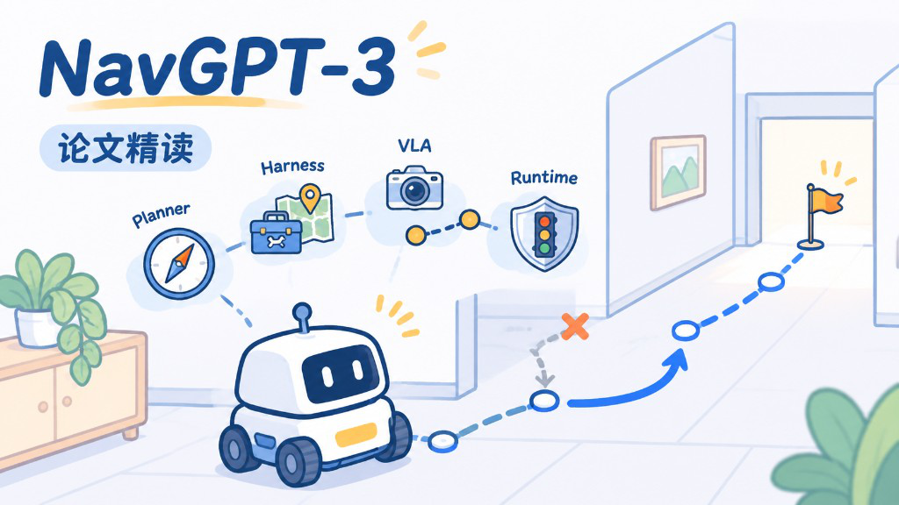
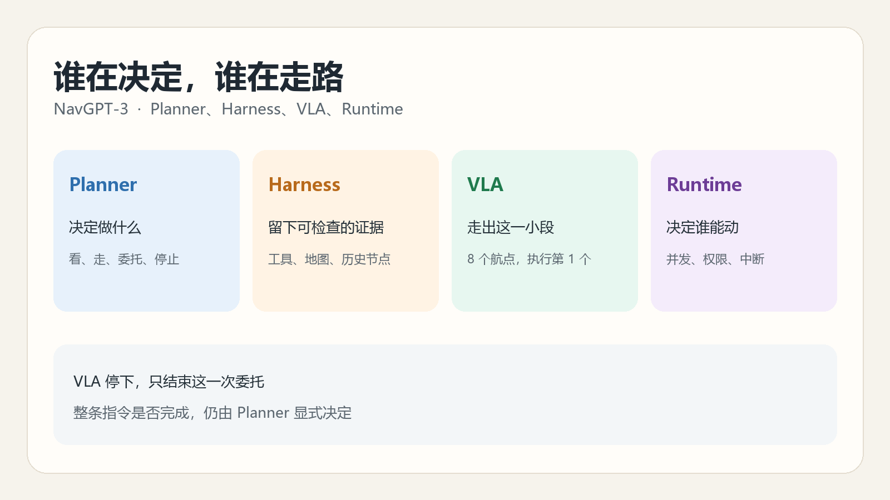
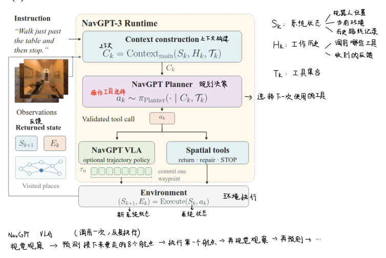
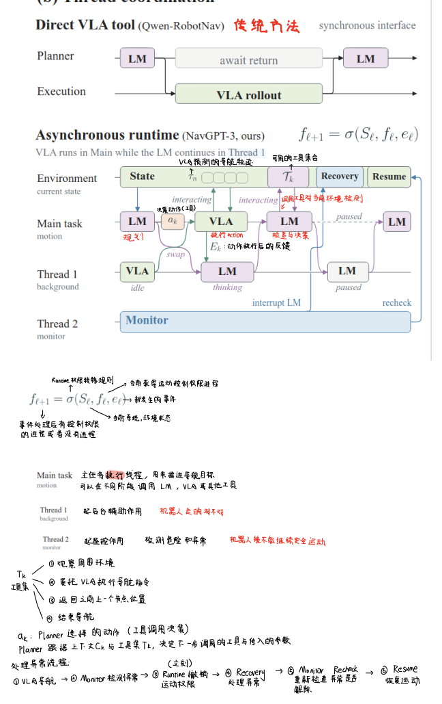
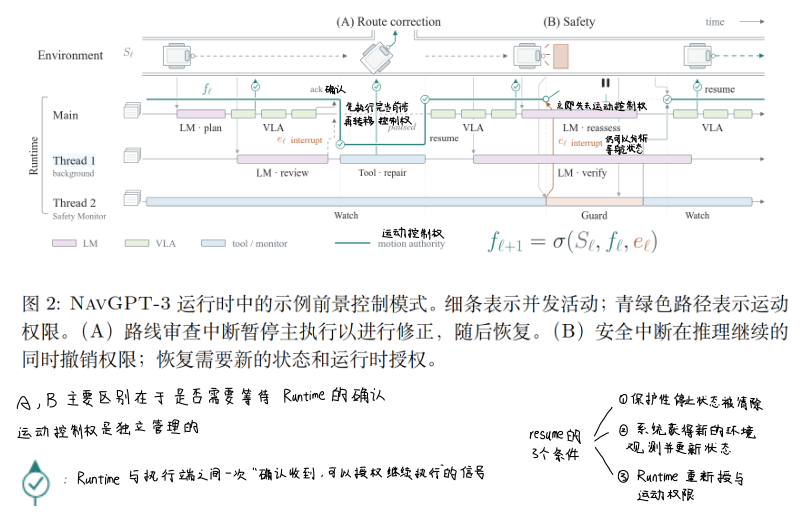
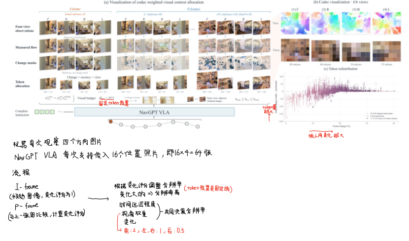
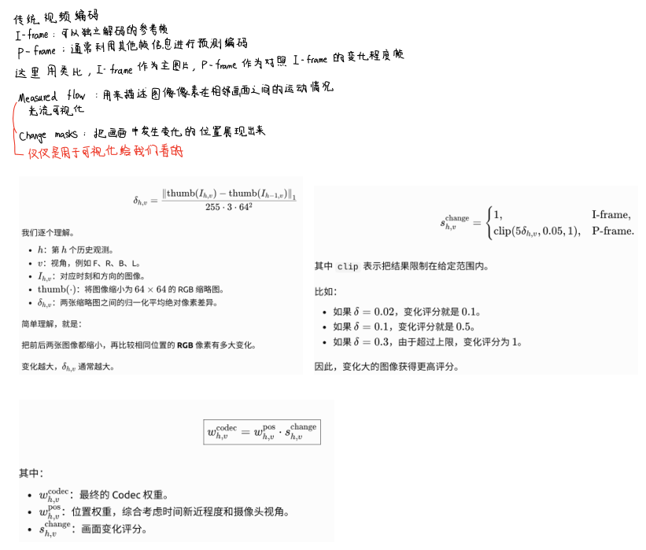
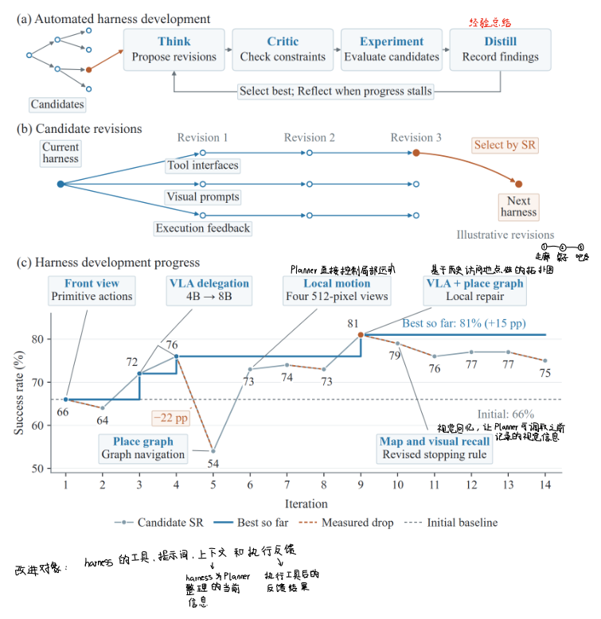
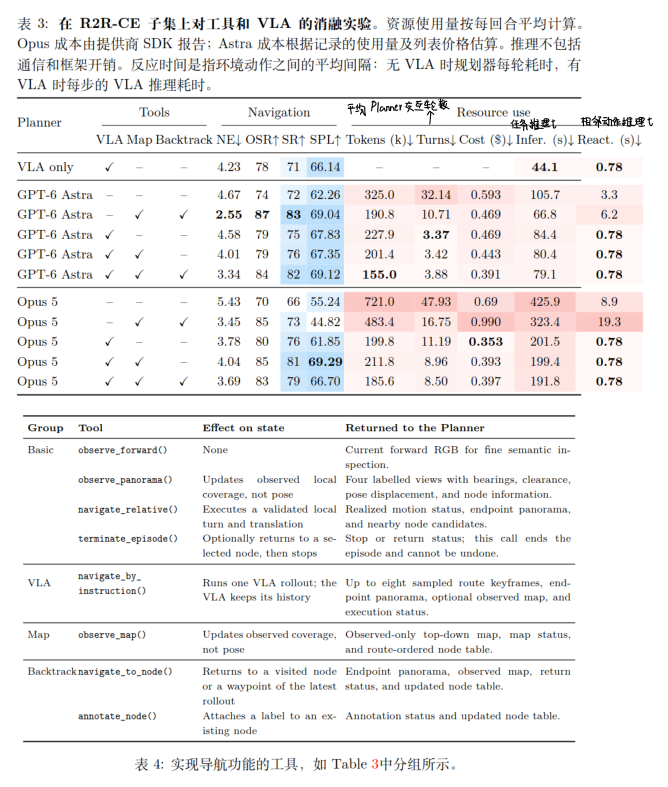
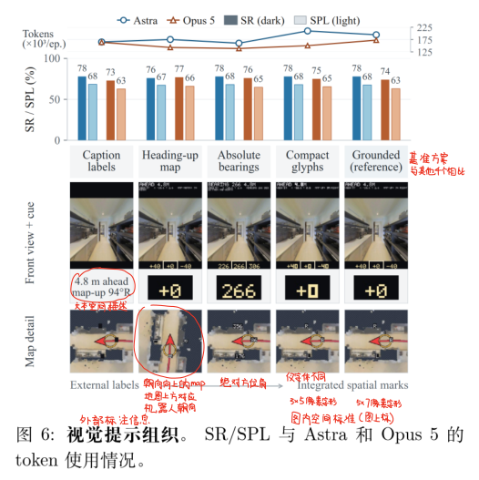

On October 25 I read [NavGPT-3](https://arxiv.org/abs/2610.10787) by following its architecture. In the [previous post](../vln-research-foundations/) I had already placed it among hybrid systems: a language model understands and checks, while a trained policy moves more frequently. This post does not explain R2R-CE again. I wanted to see what each of the four parts does, and how one part can tell whether it should continue after another part stops.

The project page is [NavGPT-3](https://metacognitionai.github.io/NavGPT3/). The numbers below come from this preprint. The full splits and the 100-episode subset should not be read as the same evaluation.

{caption="The wrong branch is marked with a cross, and the route continues to the doorway"}

## Four Responsibilities {#four-layers}

I started from what each layer takes in and gives back, rather than from the module names.

**The Planner is the decision layer.** It sees the current context and the available tools, and it outputs one tool call: look around, move locally, hand part of the instruction to the VLA, or end the task.

**The Harness is the information and tool layer.** It turns images, the instruction, and history into a context the Planner can read, exposes spatial tools, and records visited places and the result of the latest execution.

**The VLA is the motion-prediction layer.** NavGPT VLA predicts the next short trajectory from the navigation instruction and visual observations. It does not declare that the whole instruction is finished.

**The Runtime is the coordination layer.** The Planner, the VLA, and safety monitoring can proceed at the same time, but the Runtime decides who may move the robot at each moment. The environment is what actually executes motion and returns sensor results.

My shorthand is: **the Planner decides what to do, the VLA turns an instruction into the next waypoints, the Harness makes the rollout inspectable afterward, and the Runtime decides who holds motion authority now.**

{caption="Deciding, keeping evidence, moving a short distance, and holding motion authority are four different jobs"}

The paper figures below come from this preprint. The red notes and arrows are what I marked while reading.

{caption="Context goes to the Planner first. Execution then falls to the VLA or the spatial tools"}

## Two Ways the Harness Can Move {#harness}

Calling the Planner on every perception and motion update is impractical. The Harness therefore gives it two ways to move: call spatial tools itself, or delegate continuous navigation to the VLA. Delegation is optional. The Planner can finish the decisions with the existing tools, or hand over the instruction when it judges that appropriate.

These interfaces were not fixed first and explained later. The paper uses recursive self-improvement (RSI) to try tool definitions and visual prompts, then ablates the interfaces that remain. I come back to that search later. Here I first want to see what the Planner can actually call.

### Eight Tools in Four Groups {#tools}

Four basic tools are always available:

| Tool | Role |
| ---- | ---- |
| `observe_forward()` | Look at the forward image for finer semantic checks |
| `observe_panorama()` | Look forward, right, back, and left, with bearings, clearance, pose displacement, and node information |
| `navigate_relative()` | Make one local move with a given turn and distance |
| `terminate_episode()` | End the whole task explicitly |

Three further groups can be added. `navigate_by_instruction()` gives the full or remaining instruction to the VLA, which continues until it signals a stop or reaches the step limit of one delegation. What comes back is at most eight keyframes, the endpoint observation, and the execution status. `observe_map()` returns a top-down view of the area observed so far, with visited places numbered in order. `navigate_to_node()` returns to a visited place, and `annotate_node()` attaches a semantic label to it.

A node number only says where the robot has been. The Planner can label it with something that matters to the instruction, such as "beside the table." History is then not only a list of coordinates. It can also remember what that place meant.

I separate the spatial information from `observe_panorama()` by where it comes from. Bearings come from the camera orientation relative to the robot, clearance from geometric information maintained by the environment, pose displacement from translation and rotation relative to the previous pose, and node information from the history kept by the Harness.

### A VLA Stop Is Not Task Completion {#vla-stop}

This was easy for me to collapse into one event. A VLA stop may only mean that it considers the current stretch of navigation finished. It does not mean that the user's whole instruction is done.

The paper makes completion an explicit operation. A VLA stop ends only that delegation. The episode ends when the Planner calls `terminate_episode()`. Ending may first return to a selected node, and that call cannot be undone.

Repair also comes in two forms. Returning to a visited place uses `navigate_to_node()`. Turning by an angle and moving a short distance uses `navigate_relative()`. Annotation keeps the meaning of a place, and termination makes "finished" explicit.

## The Runtime Manages Concurrency and Motion Authority {#runtime}

If the robot waits for the Planner to finish thinking before every move, it stands still. The NavGPT-3 runtime separates reasoning, execution, and monitoring into threads, each with its own context, tools, and permissions.

I follow the paper's division of labor. The main task thread makes navigation decisions and can switch between the language model and the VLA. Another thread lets the VLA keep executing, so the robot does not have to wait while the Planner inspects the route. The monitor thread handles danger and anomalies, and it must be able to stop motion that should not continue.

{caption="The upper path waits for the whole VLA rollout. Below, execution, reasoning, and monitoring overlap"}

At each event, motion authority has two possibilities: it is given to one authorized thread, or it is given to no one. A thread may move the robot only if both conditions hold. It is the thread that currently holds motion authority, and the action belongs to the operations it is allowed to perform. Even if the monitor proposes "return to a node," that navigation tool is outside its permissions.

Concurrency creates a direct problem. An event can be valid when it is produced and stale by the time the runtime handles it. Each event carries its operation, permission version, timestamp, and sequence number. Outdated review or completion events are discarded, so an operation that has already been interrupted does not continue.

Revoking permission is not enough by itself. A command filter is still needed, because VLA prediction and physical execution are asynchronous. The VLA may already have produced a forward waypoint, the monitor may then revoke motion authority because of an obstacle, and the old command may arrive at the robot later. The permission version changes when authority is revoked or replaced, and a waypoint issued under the old version cannot move the robot.

Clearing a safety alert does not resume motion. The protective stop has to be cleared, fresh observations and state have to be available, and the runtime has to grant motion authority again.

{caption="Route repair pauses the main execution. A safety interrupt revokes motion authority while reasoning continues"}

Episode limits take priority over ordinary review. Once the environment-step limit, the delegation-step limit, the Planner-call limit, or the timeout is reached, the robot does not keep moving just to inspect the route. The appendix settings are at most 500 environment steps for the episode, 200 steps for one VLA delegation, 200 Planner calls, and a timeout of 2,400 seconds.

## How the VLA Looks within a Visual Budget {#visual-budget}

NavGPT VLA starts from Qwen3-VL-Instruct and adds an MLP action head. The head outputs eight waypoints. Each waypoint is a forward position, a lateral position, and a relative heading in the current robot frame. The robot executes only the first waypoint, observes again, and predicts the next trajectory. The 4B and 8B models share this output.

The visual context is bounded. The policy keeps at most 16 past observations, and each observation can contain front, right, back, and left views, so at most 64 images. With a fixed token budget, not every image can be kept at the highest resolution.

Position-only allocation weights an image by how recent it is and which view it comes from. More recent observations receive higher weight, and in the reported setup the forward view is usually preferred to the back view. This rule knows when and from which direction an image was taken. It does not know whether the image shows anything new.

Codec allocation multiplies that position weight by a change score. Within one view, the first image is an I-frame and receives a change score of 1. Each later P-frame is reduced to a 64 by 64 thumbnail, compared with the previous thumbnail by mean absolute pixel difference, and clipped into a range. Images that change more receive a higher score. Optical flow and change masks only show frame-to-frame differences to a reader. The allocation itself uses the thumbnail score.

Allocation happens before an image enters the visual encoder. The image is resized to the token count it received, rather than encoded first and then trimmed arbitrarily.

{caption="With a fixed budget, views that change more receive higher resolution. The flow field only shows the difference"}

{caption="An I-frame gets a full score. Later frames use the pixel difference of a 64 by 64 thumbnail"}

The change score does not always matter. If the ratio of budget to capacity is already at least 1, every image can reach its allocation cap and the two rules agree. Only when the budget cannot give every image that cap do tokens move from low-change images toward high-change images. Training samples the visual budget from 1,024 to 4,096 so that histories which actually require this trade-off appear.

The training data is also not a separate policy for every task. The full mixture has about 19.28 million effective records per epoch, drawn from several tasks, platforms, and camera setups, with one action-output format. Evaluation still uses each benchmark's own test tasks and metrics. Rewritten training data does not stand in for the test set.

## The Interface Was Searched For {#rsi}

RSI is set up here as a constrained tree search. Each round has four steps: propose a change from the current framework and the record of failures, check whether the change respects the interface and repeats a known failure, run it in the task environment and measure the result, then record what worked, why something failed, and which hypothesis is still untested. When progress stalls, the search reflects.

What changes is the Harness: the system prompt, the available tools, the persistent spatial state, and the way observations and execution results are shown to the Planner. This stage does not retrain the VLA.

Candidates are compared on a fixed 100-episode sample from the R2R-CE training split. Those scenes are disjoint from Val-Unseen, and the selection signal is success rate. On this development curve, front-view observation with primitive steps scores 66%. Delegating to the VLA reaches 72% with the 4B policy and 76% with the 8B policy. Adding spatial tools reaches a development best of 81%. An early place-graph interface falls to 54%, and the later consolidated interface scores 77%. One review found that the prompt described local movement while no such tool existed. A later revision added the tool and replaced the stitched panorama with four separate 512-pixel views.

{caption="The search changes tools, prompts, and execution feedback. The 81% comes from the 100-episode development subset"}

> [!NOTE]
> The 66% and 81% here come from the 100-episode training subset used to search for a Harness. They are not the same evaluation as the full Val-Unseen results below.

## What Tools and Visual Layout Each Change {#what-changes}

The tool ablation also uses 100 R2R-CE episodes. The two Planners are GPT-6 Astra and Claude Opus 5, and the VLA is the 8B model. Only the tools exposed to the Planner change.

{caption="On the same hundred episodes, tools change success. With the VLA, reaction time is about 0.78 seconds"}

With only the basic tools, every environment action waits for a Planner decision. Astra reaches 72% success at about 325.0k tokens per episode. Opus reaches 66% at about 721.0k tokens. Adding the map and backtracking raises the two results to 83% and 73%, while cutting tokens by about 41% and 33%. The map lets the Planner assemble spatial context beyond the current view, and backtracking lets it return to a recorded place instead of searching with repeated observations and short moves.

The VLA always shortens the reasoning loop, but it does not always raise success. Opus moves from about 73% to 76%–81%, and the cost per episode falls from about $0.99 to $0.35–$0.40. Astra's turn count drops sharply, but success falls to about 75%, because tokens saved on navigation are spent supervising and correcting the VLA. Once the VLA also receives mapping and backtracking, token use reaches the low point in this table for both models: 155.0k for Astra and 185.6k for Opus, with success close to each model's best row.

My reading is: **what the VLA adds to success depends on whether the Planner can already understand the environment.** When the language model is strong enough, the ceiling on success comes more from its own navigation ability than from a missing interface. The clearer effect of the interface is then to reduce cost.

Reaction time is a separate question. Without the VLA, the system can act only as often as the language model decides, about once every 3 to 19 seconds. With the VLA, the 8B model predicts a step in about 0.78 seconds on average.

Check frequency reverses the bargain. Without periodic checks, the Planner usually waits until the VLA stops or hits the delegation limit, after a median of about 51 steps. Checking every 32 steps moves success only from 77% to 78%. Checking every 16 steps reaches 83% success, raises SPL from 67.51% to 77.36%, and lowers navigation error from 3.82 m to 2.01 m, while tokens rise from 179.2k to 2,319.5k per episode. More frequent checks can improve the route, and the cost grows faster than the accuracy.

The visual-prompt study keeps the tools and environment information fixed and changes only how they are shown to the Planner. The paper compares five presentations, including moving labels into text beside the image, using smaller digits, rotating the map with the robot, and replacing relative turn cues with absolute bearings. Astra's success stays around 76%–78%, and Opus stays around 73%–77%. Absolute bearings, which are harder for a person to read, use the fewest tokens for both models. **Success is not very sensitive to visual layout, token cost is, and the layout that is easiest for a person is not necessarily the one a language model uses most cheaply.**

{caption="Success stays close across the five layouts. Token use does not fall in the order a person would find easiest to read"}

## Results on the Full Splits {#full-results}

Table 6 is the full Val-Unseen evaluation on R2R-CE and RxR-CE. The 8B NavGPT VLA alone reaches 76.94% SR and 70.61% SPL on R2R-CE, and 82.39% SR on RxR-CE. For comparison, Qwen-RobotNav 8B reaches 72.1% and 76.5% SR on these two sets.

With the Harness, the GPT-6 Astra configuration raises R2R-CE SR to 81.51%, with 70.42% SPL. Claude Opus 5 reaches 79.01% SR and 70.16% SPL. On RxR-CE, Astra reaches 90.43% SR and 78.47 nDTW. The paper places this next to English human followers at 90.4% SR and 77.7 nDTW. The human demonstrations follow a discrete navigation graph, while the system uses continuous control. The paper states that difference itself.

On R2R-CE, success rises without a similarly clear gain in SPL. RxR instructions are longer and specify more of what must be passed along the way, so returned route evidence, visited nodes, and local repairs have more to act on. Success and path fidelity rise together there. **A higher completion rate does not by itself mean a shorter path.**

Object-goal navigation gives the robot an object to find and reach. The paper evaluates 500-episode subsets of MP3D and HM3D v2, and success also requires stopping within the distance threshold while facing the target. Passing near the object is not enough. The comparable range differs too: earlier methods often use HM3D v1, while this evaluation uses v2. Embodied question answering requires moving, observing, and then answering a question about the environment. For these two tasks I first keep the task definition and the stop condition, and I do not compare their scores directly with full-split VLN success.

The effect of codec allocation also depends on the model and the data. In the training ranges compared by the paper, the 8B model gains success from change-aware allocation throughout. On R2R-CE, the 4B model shows that gain after cross-embodiment data is added. With cross-embodiment data, both 4B and 8B improve SR and SPL on both test sets. A larger model is usually better, but data coverage can outweigh parameter count: the 4B model trained with cross-embodiment data can surpass the 8B model trained only on VLN data. Growing the mixture from about 11.57 million to 19.28 million records still has not flattened the curve.

For the real-robot section I only keep the division of responsibility. Onboard inference places the 4B VLA on the robot's Jetson Thor, with FP8 quantization and TensorRT, and removes the network round trip for VLA prediction. The Planner stays remote. Overlapped execution mainly improves the efficiency of route repair. Priority monitoring mainly improves how quickly a safety stop and a permission change take effect.

## What Makes a Wrong Route Repairable {#repair}

I do not read Figure 10 as evidence that the VLA stops at the correct endpoint by itself. What I want to remember is that the VLA can overshoot, and the Planner can still recover the error from evidence kept by the Harness.

The instruction requires the robot to pass a table and remain in the corridor. One VLA delegation runs for 67 steps and enters the bedroom. The Planner compares the instruction with the returned keyframes, decides that the endpoint should still be in the corridor, and returns to node 1 beside the table. Being beside the table does not yet satisfy "just past the table," so it adjusts its heading, moves forward about 1.2 meters, confirms from the back view that the table is behind it, and only then calls termination.

The figure uses three numbering schemes. Sampled visual keyframes, historical nodes stored by the Harness, and the order of the Planner's tool calls are not one sequence. The paper also does not say whether the VLA stopped in the bedroom because it knew the bedroom was off the route. What is definite is that task completion is not inferred from that stop.

The blocked aisle and the missed turn use the same method. After the VLA stops, the Planner checks which clause is still unfinished. When another local move fails, it uses `navigate_to_node()` to return to an earlier place and `navigate_relative()` to take another aisle. In the stair episode, the Planner first tries to climb with local motion, does not succeed, hands the full instruction back to the VLA near the stove, and checks the bed, door, and toilet only after the robot is upstairs.

Together these episodes do not say that the VLA is correct. They say that an error has to remain as a route, nodes, and status that can be inspected, or the Planner has nothing to repair.

The appendix leaves one question that I am not turning into a conclusion. After two consecutive blocked steps, the system records a review request, but the Planner is not woken immediately. It waits for the next periodic check. If that check would have happened anyway, does the earlier request change what the Planner sees, or does it only mark that a blockage occurred? The interaction-frequency experiment does not separate this. I am leaving the question here.

## Review {#review}

This time I keep the four layers first, and then three boundaries that are easy to mix together.

A VLA stop and task completion are not the same event. Visual tokens are first allocated by time and view. Scene change changes who receives more tokens only when the budget is not large enough for every image. Motion authority, the permission version, and the command filter have to be read together. Otherwise an old waypoint can still move the robot while threads run concurrently.

Tools mainly change whether the Planner can understand and repair a route efficiently. Visual layout mainly changes token cost. The VLA mainly changes how soon the robot can act. Success, path efficiency, and reaction time are therefore not one number. When I return to a table, I also write down first whether it is the 100-episode development subset or the full Val-Unseen split.
