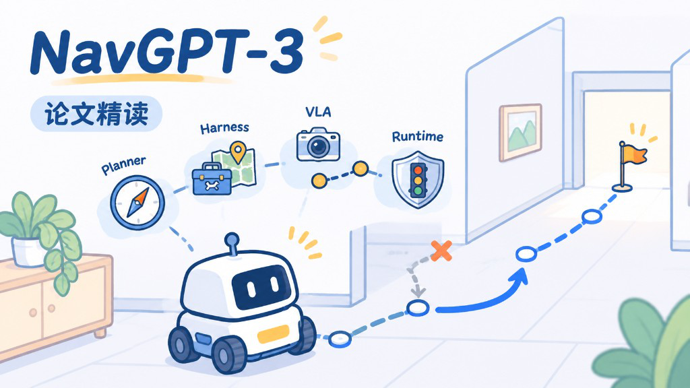
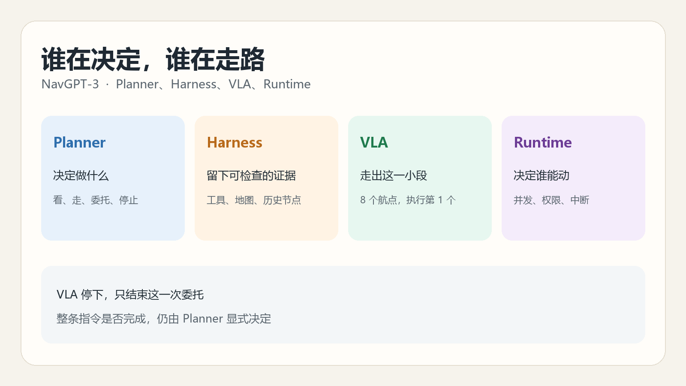
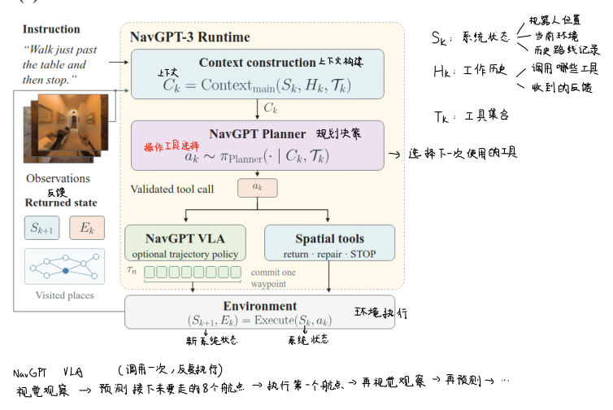
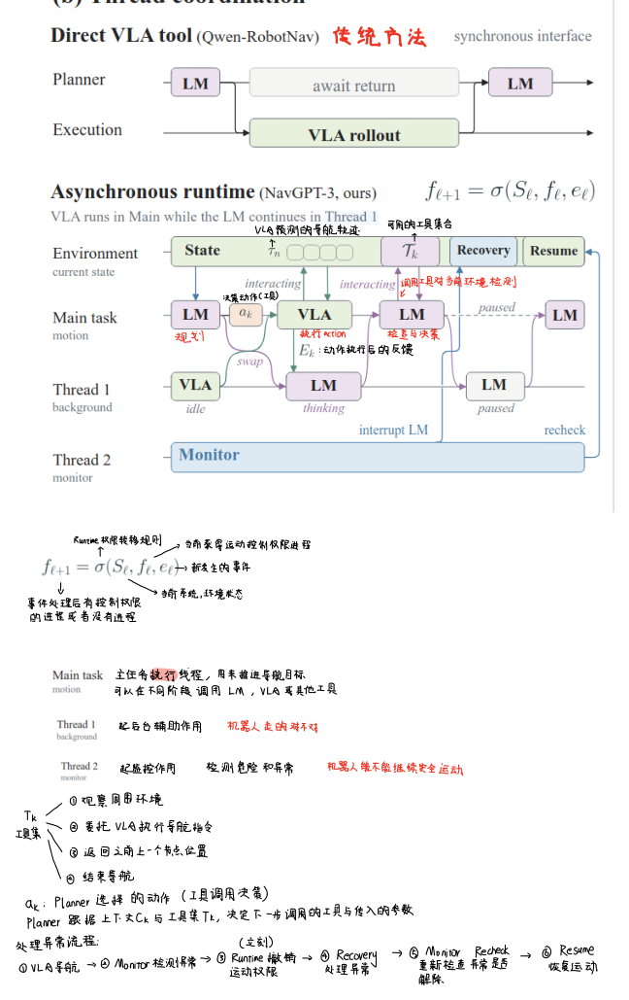
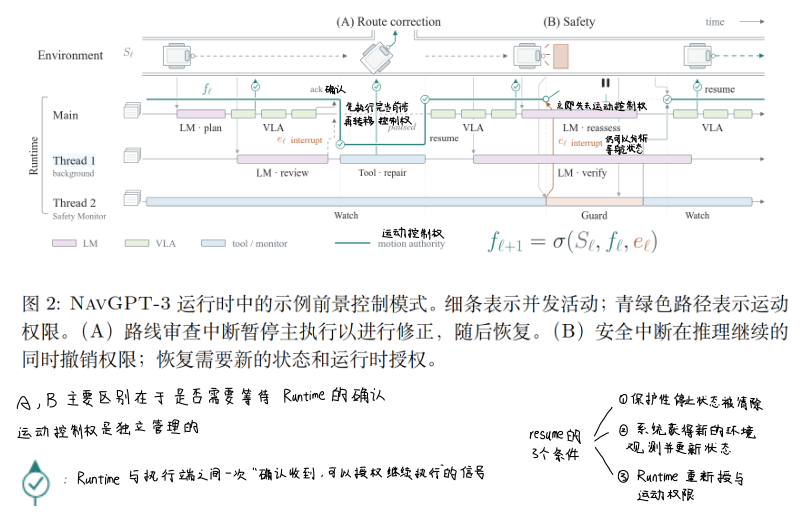
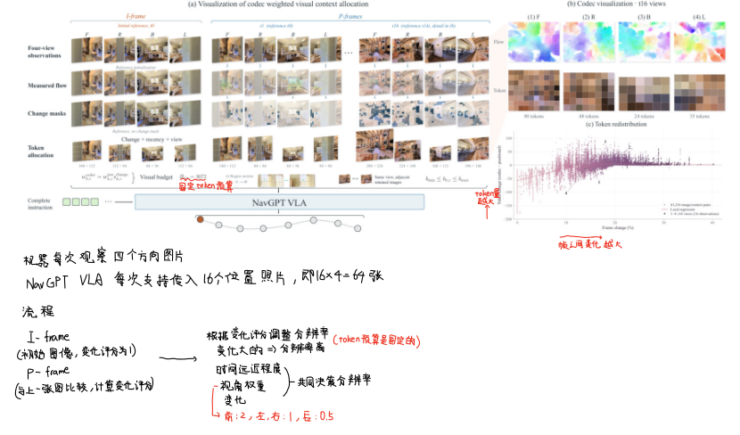
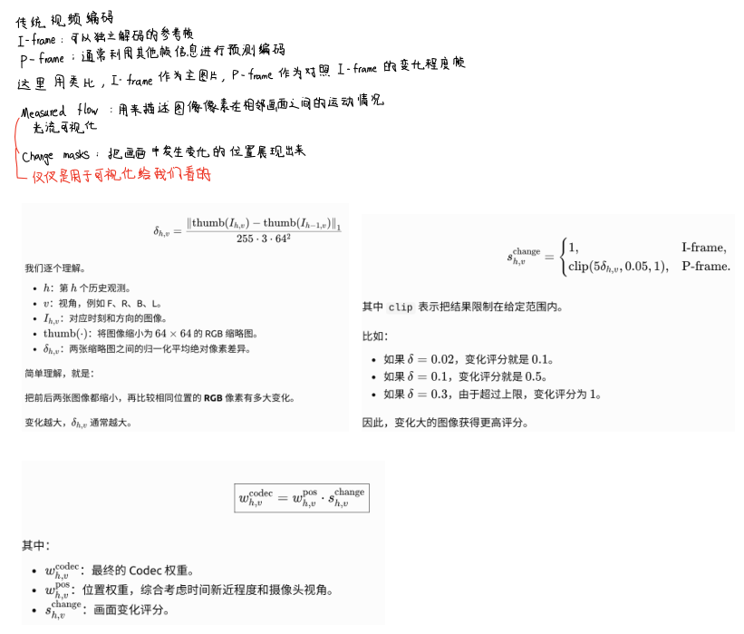
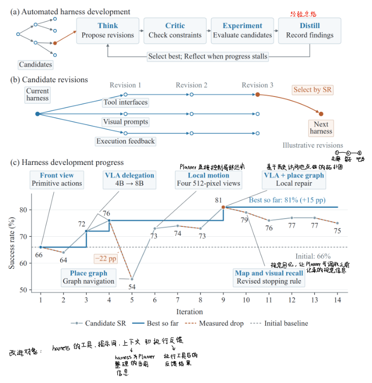
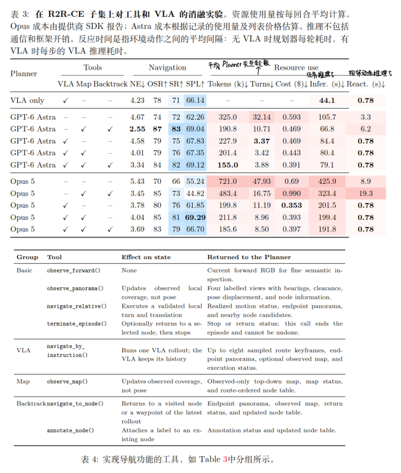
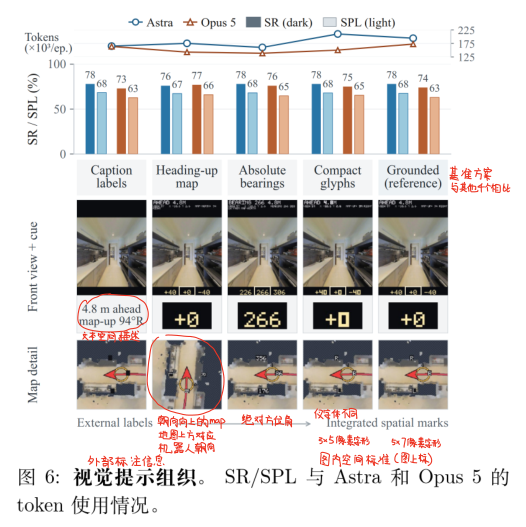

10 月 25 日我顺着架构读了一遍 [NavGPT-3](https://arxiv.org/abs/2610.10787)。[上一篇](/blog/vln-research-foundations/)里我已经把它归到混合系统：上层语言模型负责理解和检查，训练过的策略负责更高频地往前走。这次不再重讲 R2R-CE 是什么，只想看清四块各自做什么，以及一块停下的时候，另一块凭什么知道该不该继续。

项目页在 [NavGPT-3](https://metacognitionai.github.io/NavGPT3/)。下面的数字来自这篇预印本，完整划分和 100 条子集不要混在一起看。

{caption="走错的那段标上叉，再沿正确的路走到门口"}

## 先分清四层职责 {#four-layers}

我先不按模块名字记，而是按每一层吃进什么、吐出什么来记。

**Planner 是决策层。** 它看到当前上下文和可用工具，输出一次工具调用：观察周围、局部移动、把一段指令交给 VLA，或者结束任务。

**Harness 是信息和工具层。** 它把图像、指令和历史状态整理成 Planner 能读的上下文，提供空间工具，并记下走过的位置和这次执行的结果。

**VLA 是运动预测层。** NavGPT VLA 根据导航指令和视觉观察，预测接下来的一小段轨迹，不负责宣布整条指令已经完成。

**Runtime 是协调层。** Planner、VLA 和安全监视可以同时进行，但同一时刻谁能让机器人动，由它分配。真正执行运动、返回传感器结果的是环境。

所以我把它收成一句：**Planner 决定做什么，VLA 把指令变成接下来的航点，Harness 让这个过程事后还能检查，Runtime 决定此刻谁握着运动权。**

{caption="决策、证据、短距离运动和运动权是四件不同的事"}

下面的原图都来自这篇预印本，红字和箭头是我读的时候标上的。

{caption="上下文先交给 Planner，真正执行则落到 VLA 或空间工具"}

## Harness 提供的两种走法 {#harness}

调用 Planner 做每一次感知和运动更新并不现实。Harness 因此给了它两种走法：自己调用空间工具，或者把连续导航委托给 VLA。后一种是可选的。Planner 可以完全靠现有工具做完决策，也可以在认为适合时再把指令交出去。

这些接口不是先写死再解释的。论文用递归自我改进（RSI）去试工具定义和视觉提示，再把留下来的接口拿去做消融。这一点我放到后面单独看。这里先看 Planner 手里到底有什么。

### 八个工具分成四组 {#tools}

基础的四个工具每次都在：

| 工具 | 作用 |
| ---- | ---- |
| `observe_forward()` | 看前方图像，做较细的语义确认 |
| `observe_panorama()` | 看前、右、后、左四个方向，并带上方位、可通行距离、位姿变化和节点信息 |
| `navigate_relative()` | 按给定转角和距离做一次局部移动 |
| `terminate_episode()` | 显式结束整个任务 |

另外三组可以加上。`navigate_by_instruction()` 把整段或剩余指令交给 VLA，VLA 一直走到自己认为该停，或走到单次委托的步数上限。回来的是沿途最多 8 张关键帧、终点观察和执行状态。`observe_map()` 给出目前观察过的区域的俯视图，到过的位置按访问顺序编号。`navigate_to_node()` 可以回到某个已访问位置，`annotate_node()` 给这个位置加上语义标注。

节点编号本身只表示到过哪里。Planner 可以把它标成“桌子旁边”这类任务里有意义的话。于是历史不只是一串坐标，也可以记住那个地方对指令意味着什么。

`observe_panorama()` 返回的空间信息，我按来源分开记。方位来自相机相对机器人的朝向，可通行距离来自环境维护的几何信息，位姿变化来自相对先前位置的平移和旋转，节点信息则是 Harness 自己保存的历史。

### VLA 停止不等于任务完成 {#vla-stop}

这里我原先容易混成一件事。VLA 停下，可能只是它认为当前这段导航可以结束，并不表示用户的整条指令已经做完。

论文把完成状态做成显式操作：一次 VLA 停止只结束这次委托，整段任务要等 Planner 调用 `terminate_episode()`。结束时还可以先回到选定节点，这次调用不能撤销。

修正也分两种。回到已访问位置，用的是 `navigate_to_node()`。只需要转一个角度、再走一小段，用的是 `navigate_relative()`。标注负责把语义留下来，终止负责把“做完了”说清楚。

## Runtime 管的是并发和运动权 {#runtime}

如果每次都等 Planner 想完再动，机器人会停在原地。NavGPT-3 的运行时把推理、执行和监视分成线程，各自有上下文、工具和权限。

我按论文里的分工来理解：主任务线程负责导航决策，可以在语言模型和 VLA 之间切换；另一条线程让 VLA 继续执行，这样 Planner 还在看路线时机器人不必干等；监视线程负责危险和异常，该停的时候不能继续走。

{caption="上面要等 VLA 整段返回；下面执行、推理和监视可以重叠"}

运动权在每个事件上只有两种情况：交给某一个获得授权的线程，或者暂时谁也不给。一个线程要让机器人动，必须同时满足两件事：它正是当前持有运动权的那个线程，而且这个动作属于它被允许的操作。监视线程即使提出“回到某个节点”，这个导航工具也不在它的权限里。

并发带来一个直接的问题：事件产生时可能有效，等运行时真正处理时，状态已经变了。每个事件带着所属操作、权限版本、时间戳和序列号。过期的审查或完成事件会被丢掉，不能让一个已经中断的操作继续执行。

权限被撤销之后，还需要命令过滤。VLA 的预测和机器人真正执行是异步的。它可能已经算出一个前进航点，监视线程随后因为障碍撤销了运动权，这条旧指令仍可能晚一点才到达机器人。权限版本会在撤销或更换时更新，旧版本下的航点不能再让机器人动。

安全恢复也不是把警报清掉就继续。保护性停止解除、拿到更新后的观察和状态、运行时重新授予运动权，这三件事都要发生。

{caption="路线修正会先暂停主执行；安全中断则在推理还在继续时撤掉运动权"}

回合限制优先于普通审查：环境步数、单次委托步数、Planner 调用次数或超时已经到了，就不能再为了检查路线继续走。论文附录里的设置是整段任务最多 500 个环境步、单次 VLA 委托最多 200 步、Planner 最多 200 次调用、超时 2400 秒。

## VLA 怎样在有限视觉预算里看路 {#visual-budget}

NavGPT VLA 从 Qwen3-VL-Instruct 出发，后面加一个 MLP 动作头。动作头输出 8 个航点，每个航点是当前机体坐标系里的前后位置、左右位置和相对朝向。机器人只执行第一个航点，然后重新观察，再预测下一条轨迹。4B 和 8B 用同一种输出。

视觉上下文有上限。它最多保留 16 次历史观察，每次可以有前、右、后、左四个视角，一共最多 64 张图。总 token 预算固定时，就不能把每张图都放到最高分辨率。

只按位置分配时，权重看的是这张图有多新、来自哪个视角。越近的观察权重越高，实验设置里前方通常也高于后方。这个规则知道图像是何时、从哪个方向拍的，不知道画面里有没有新内容。

Codec 分配是在这个位置权重上再乘一个变化分。同一视角里，第一张作为 I 帧，变化分直接是 1。后面的 P 帧先缩成 64×64 的缩略图，和上一张比平均绝对像素差，再把这个差限制到一个区间里。变化大的图像分数更高。光流和变化掩码只是给人看帧间差别，真正参与分配的是这个缩略图分数。

分配发生在图像进入视觉编码器之前：按分到的 token 数量调整分辨率，而不是编码完再随便丢掉一些 token。

{caption="预算固定时，变化更大的视角分到更高分辨率；光流只是给人看差别"}

{caption="I 帧记满分，后面的帧用 64×64 缩略图的像素差"}

变化分不是随时都有用。预算相对容量的比例如果已经大于等于 1，每张图都能拿到分配上限，两种规则结果一样。只有预算不够让所有图都到上限时，token 才会从变化小的图转向变化大的图。训练时会把视觉预算随机取在 1024 到 4096 之间，让这种需要取舍的历史真正出现。

训练数据也不是为每个任务单独做一个策略。完整混合物大约每轮 1928 万条有效记录，来自多种任务、平台和相机配置，动作输出格式是统一的。评估仍用各基准自己的测试任务和指标，不用改造过的训练数据代替测试。

## 这套接口是搜出来的 {#rsi}

RSI 在这里被做成一种带约束的树搜索。每一轮大致是四步：根据当前框架和失败记录提出修改，检查修改是否符合接口约束、是否重复已知失败，在任务环境里跑并测量结果，再记下有效修改、失败原因和还没验证的假设。进展停住时再反思。

搜索改的是 Harness：系统提示、可用工具、持久的空间状态，以及观察和执行结果怎样呈现给 Planner。它不是在这一步重新训练 VLA。

候选方案在 R2R-CE 训练集里固定抽出的 100 条上比较，场景和后面的 Val-Unseen 不相交，选择信号是成功率。这条开发曲线里，只有前视和基本步进是 66%；交给 VLA 后，4B 到 72%，8B 到 76%；再加上空间工具，开发过程中最好到过 81%。早期的地点图接口掉到 54%，后来整理过的接口是 77%。有一次审查发现，提示里写了局部移动，当时却没有对应工具，后面才补上，并把拼接全景换成四张 512 像素的分视角图像。

{caption="搜索改的是工具、提示和执行反馈；81% 来自 100 条开发子集"}

> [!NOTE]
> 这里的 66%、81% 是搜索 Harness 用的 100 条训练子集。它和后面完整 Val-Unseen 上的结果不是同一次评测。

## 工具和画面组织各自改变什么 {#what-changes}

工具消融同样在 100 条 R2R-CE 上做，两个 Planner 是 GPT-6 Astra 和 Claude Opus 5，VLA 用的是 8B。只有暴露给 Planner 的工具在变。

{caption="同一百条任务上，工具改变成功率；接上 VLA 后反应时间大约是 0.78 秒"}

只有基础工具时，每一步环境动作都要等 Planner 决定。Astra 的成功率是 72%，每条大约 325.0k token；Opus 是 66%，大约 721.0k token。加上地图和回溯之后，两者分别到 83% 和 73%，token 大约减少 41% 和 33%。地图让 Planner 不必只靠当前画面拼空间，回溯让它可以直接回到已记录的位置，而不是反复用观察和短移动去找路。

VLA 一定能缩短推理回合，但不一定提高成功率。Opus 从大约 73% 升到 76%–81%，每条成本也从大约 0.99 美元降到 0.35–0.40 美元。Astra 的回合数明显下降，成功率却掉到 75% 左右，因为省下来的推理又花在监督和纠正 VLA 上。给 VLA 也配上地图和回溯之后，两边的 token 都到了这张表里的低点：Astra 155.0k，Opus 185.6k，成功率接近各自最好的一档。

我的理解是：**VLA 对成功率的贡献，取决于 Planner 自己是不是已经能看懂环境。** 语言模型足够强时，成功率的上限更多来自它自己的导航能力，而不是接口还缺不缺。接口此时更明显的作用是把开销降下来。

反应时间是另一件事。没有 VLA 时，系统多久能动一次，取决于语言模型多久做一次决定，大约 3 到 19 秒。有 VLA 时，8B 模型平均大约 0.78 秒预测一步。

检查频率会把这件事反过来。完全不定期检查时，Planner 多半要等 VLA 自己停，或走到委托上限，中位大约 51 步。每 32 步检查一次，成功率只从 77% 到 78%。每 16 步检查一次，成功率到 83%，SPL 从 67.51% 到 77.36%，导航误差从 3.82 米降到 2.01 米，但每条 token 从 179.2k 升到 2319.5k。查得更勤，路线可以更好，代价涨得更快。

视觉提示组织保持工具和环境信息不变，只改变这些信息怎么摆给 Planner。论文比较了五种做法，包括把标注写在图外文字里、换成更小的数字、让地图随机器人朝向转动，以及用绝对方位代替相对转向。Astra 的成功率大约停在 76%–78%，Opus 大约在 73%–77%。对人来说更难读的绝对方位，两个模型用的 token 反而最少。**成功率对画面组织不太敏感，token 开销敏感，而且适合人读的排法不一定适合语言模型。**

{caption="五种组织的成功率接近，token 并不按人的阅读习惯下降"}

## 完整划分上的结果 {#full-results}

表 6 才是 R2R-CE 和 RxR-CE 的完整 Val-Unseen。单独的 8B NavGPT VLA 在 R2R-CE 上 SR 为 76.94%、SPL 为 70.61%，在 RxR-CE 上 SR 为 82.39%。作为对照，Qwen-RobotNav 8B 在这两个集合上的 SR 是 72.1% 和 76.5%。

接上 Harness 之后，GPT-6 Astra 配置的 R2R-CE SR 升到 81.51%，SPL 是 70.42%；Claude Opus 5 是 79.01% 和 70.16%。RxR-CE 上 Astra 到 90.43% SR、78.47 nDTW，论文把它和英语人类跟随者的 90.4% SR、77.7 nDTW 放在一起。人类示范走的是离散导航图，系统走的是连续控制，这个差别论文自己也写了。

R2R-CE 上成功率上升时，SPL 并没有一起明显变好。RxR 的指令更长，也更具体地规定了沿途要经过什么，返回的路线证据、历史节点和局部修正就有更多事情可做，所以成功率和路径忠实度一起提高了。**完成率上去，不自动表示路也走短了。**

目标导航是给一个物体，让机器人自己找到并到达。论文在 MP3D 和 HM3D v2 的 500 条子集上评测，成功还要求停在距离阈值内并且朝向目标，不能只是经过附近。两个集合能比的范围也不一样：较早方法常用 HM3D v1，这里用的是 v2。具身问答则要先移动、观察，再回答环境里的问题。这两类我先记住任务定义和停止条件，不把它们和 VLN 的完整划分成功率直接横比。

Codec 的作用也要看模型和数据。8B 在论文比较的各个训练范围里都能从变化分配里得到成功率提升；4B 在 R2R-CE 上要到加入跨具身数据之后才显现出来。加入跨具身数据后，4B 和 8B 在两个测试集上的 SR 和 SPL 都有提高。模型更大通常更好，但数据覆盖可以压过参数量：跨具身数据上的 4B，可以超过只在 VLN 数据上训练的 8B。从大约 1157 万条再加到 1928 万条，曲线还没有明显停住。

真机部分我只记职责划分。机载推理把 4B VLA 放到机器人上的 Jetson Thor，用 FP8 量化和 TensorRT，去掉的是 VLA 预测的网络往返。Planner 仍然在远端。重叠执行主要改善路线修正的效率，优先级监视主要改善安全停止和权限切换的及时性。

## 走错以后靠什么改回来 {#repair}

图 10 我没有把它读成“VLA 会自己停在正确终点”。更值得记的是：VLA 可以走过头，Planner 仍然能用 Harness 留下的证据把错误找回来。

那条指令要求经过桌子之后仍然停在走廊里。VLA 的一次委托走了 67 步，进了卧室。Planner 对照指令和返回的关键帧，判断终点应该还在走廊，于是回到桌子旁边的节点 1。只是回到桌子旁边仍不满足“刚经过桌子”，它再调整朝向、向前大约 1.2 米，用后视图确认桌子已经在身后，然后才调用终止。

图里其实有三套编号。抽出来的视觉关键帧、Harness 保存的历史节点、Planner 的工具调用顺序，不是同一个序列。VLA 在卧室停下，论文也没有说明它是不是知道卧室不在路线上。能确定的是，任务完成不是从这次停止推出来的。

被挡住的过道和漏掉的转弯，用的是同一套办法。VLA 停了，Planner 先检查哪一句指令还没完成；局部移动再次失败后，用 `navigate_to_node()` 回到较早的位置，再用 `navigate_relative()` 换一条通道。楼梯那例里，Planner 自己试过局部上楼，没有成功，就在炉灶附近把完整指令重新交给 VLA，上楼后再核对床、门和马桶是否都满足。

这些例子共同说明的不是 VLA 不会错，而是错误要留成可以回看的路线、节点和状态，Planner 才有东西可改。

附录里还有一个我没有收成结论的问题。连续两步受阻时，系统会记下一个审查请求，但 Planner 并不是立刻被叫醒，而是等到下一个定期检查。如果定期检查本来就会发生，这个提前记下的请求到底改变了 Planner 看到的信息，还是只是标出“刚才受阻过”？论文的交互频率实验没有把这件事分开测。我先把问题留在这里。

## 小结复盘 {#review}

这次我先记住四层，再记住三个容易混的边界。

VLA 停止和任务完成不是一回事。视觉 token 先按时间和视角分配，只有预算不够时，画面变化才会改变谁拿得更多。运动权、权限版本和命令过滤要放在一起看，否则并发时一条旧航点仍可能让机器人动。

工具主要改变 Planner 能不能高效地看懂并改路线，画面怎么排主要改变 token，VLA 主要改变多久能动一次。成功率、路径效率和反应时间因此不是同一个数。回到具体表格时，我也会先写清这是 100 条开发子集，还是完整 Val-Unseen。
