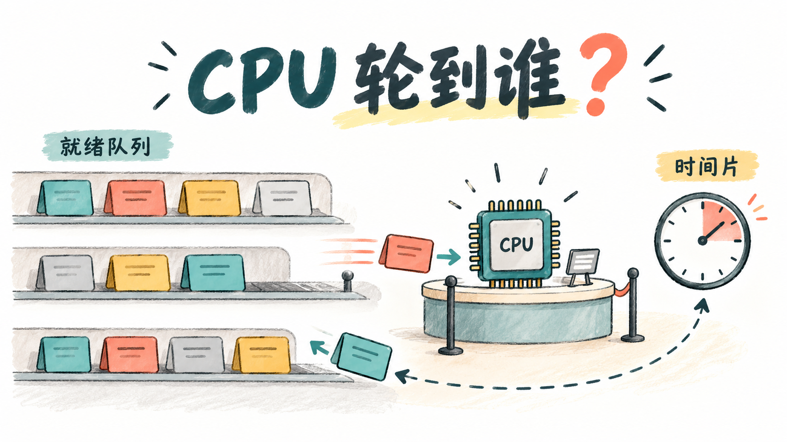

My October 20 notes focus on CPU scheduling. The [previous post](../os-basic-concepts-review/) distinguished programs, jobs, and processes, along with concepts such as concurrency and synchronous calls. This post continues with a related question: when several tasks need to run, how does the system decide who gets the CPU first, for how long, and when to switch?

I start by separating the levels of scheduling, then look at the metrics used to evaluate it, and finally compare the algorithms. Seen this way, the algorithms do more than carry different names. They address different priorities: finishing tasks sooner, responding to users sooner, or meeting deadlines.


{caption="Scheduling rules determine which task runs first and how long it uses the shared CPU"}

## Three Levels of Scheduling {#scheduling-levels}

When I first learned these levels, I focused on the decision each one makes.

**High-level scheduling, or job scheduling, decides which jobs to admit.** In the traditional batch-processing model, the system selects suitable jobs from a backing-store queue, loads them into memory, and creates processes so they can participate in execution. This controls the number and mix of jobs competing for resources.

**Medium-level scheduling, or memory scheduling, decides which processes to suspend temporarily and which to bring back into memory.** When memory is tight, the system can swap out processes that are not currently running and bring them back later. This concerns the residency and suspension of admitted processes, rather than choosing the next process to use the CPU.

**Low-level scheduling, also called process scheduling or short-term scheduling, selects the next process to run from the ready processes.** This is the level at which I mainly consider FCFS, round robin, and the other rules below.

My shorthand is: **first decide who can enter, then who stays in memory for now, and finally who runs right now.** This is a textbook model; an actual system does not have to implement three independent schedulers.

### Why Multiprogrammed Batch Systems Need Scheduling {#multiprogramming}

Batch processing means that users submit jobs for the system to organize and execute, usually without continuous interaction during execution.

Multiprogramming means that processes belonging to several jobs can reside in memory at once. When one process waits for I/O, the CPU can run another ready process, reducing idle time.

A multiprogrammed batch system therefore does not mean that several jobs execute on one CPU simultaneously. It lets several jobs participate in resource use and switches between them when appropriate. The goal is better resource utilization, not simply maintaining a queue.

## Preemptive versus Non-Preemptive Scheduling {#preemption}

To me, the essential difference is this: **while a process could still continue running, can the system take the CPU away and give it to another process?**

With non-preemptive scheduling, once a process obtains the CPU, the system normally waits until it finishes or voluntarily gives up the CPU, such as by waiting for I/O or another event, before choosing another process.

Preemptive scheduling allows the system to switch away from a process that could still run, for example when its time slice expires or a higher-priority process becomes ready.

I also need to distinguish rescheduling from preemption. If the current process has already finished and the system selects the next one, that is rescheduling, but it has not displaced a process that was still running. This distinction also matters when considering shortest-remaining-time scheduling.

## Evaluating Scheduling {#metrics}

Before comparing algorithms, I separate the metrics. A short turnaround time, a busy CPU, and a large number of completed tasks are not the same thing.

### Turnaround Time and Average Turnaround Time {#turnaround}

**Turnaround time = completion time - submission or arrival time.**

It measures the elapsed time from submitting a job to its eventual completion. This may include waiting for the CPU, executing, waiting for I/O, and other delays.

**Average turnaround time = sum of all job turnaround times / number of jobs.**

This describes how long jobs in a batch take to finish on average. CPU utilization instead measures the proportion of an observation interval during which the CPU is busy. Throughput measures the number of tasks completed per unit time. These three metrics need to be considered separately.

### Normalized Turnaround Time {#weighted-turnaround}

Turnaround time alone makes it difficult to compare jobs of different lengths. I use normalized turnaround time, also called weighted turnaround time, to see how much the total elapsed time has grown relative to the job's own service requirement:

```text
Normalized turnaround time = turnaround time / service time
```

In a simple model that ignores I/O and switching overhead, with just one CPU burst per task, service time is the required CPU time. The expression can then be expanded:

```text
Turnaround time = waiting time + service time
Normalized turnaround time = (waiting time + service time) / service time
                           = 1 + waiting time / service time
```

The parentheses matter. Writing "waiting time + service time / service time" produces a different expression. If the actual execution includes I/O or other delays, ready-queue waiting time and CPU execution time alone do not explain the entire turnaround time.

For example, suppose two jobs each finish after 10 time units. A job requiring only 2 units of execution has a normalized turnaround time of 5; one requiring 10 units has a value of 1. The former experienced more extra delay relative to its own execution requirement.

For a positive service time, this ratio is normally at least 1. In the simple model where the CPU starts idle, the first job runs immediately upon arrival, and there is no I/O or other extra delay, that job's ratio is 1. Non-preemptive scheduling alone does not guarantee all these conditions.

### Different Systems Have Different Priorities {#system-goals}

**Batch systems** mainly focus on average turnaround time, throughput, and CPU utilization. Jobs should finish sooner, the system should complete more tasks per unit time, and resources should not remain idle for long periods.

**Time-sharing systems** care more about interactive response. Users should receive responses reasonably quickly and consistently. A quick response does not mean that the entire task finishes immediately: a task can receive an opportunity to run and then continue its work later.

**Real-time systems** focus on timing constraints. The issue is not merely a good average speed, but whether important tasks finish before their deadlines and whether this behavior is predictable.

Before judging an algorithm, I therefore need to know the system's priorities. A policy with a shorter average turnaround time does not necessarily provide the best interactive response.

## Common Scheduling Algorithms {#algorithms}

For now, I use a simplified textbook model with a single processor. Execution time represents the service requirement of a job or its current CPU burst. Actual systems generally need to estimate these times rather than know in advance how long a process will run.

### First-Come, First-Served: FCFS {#fcfs}

FCFS means First-Come, First-Served. Its central rule is arrival order. A newly ready process joins the tail of the ready queue, and the scheduler selects from the head.

It is normally non-preemptive and can also be used for job scheduling. It is simple to implement, and tasks already waiting are not repeatedly overtaken by newer arrivals.

But fairness in queue order does not imply a short wait. If a very long task starts first, much shorter tasks behind it still have to wait. In the usual model where preceding tasks eventually release the CPU, continued new arrivals do not indefinitely postpone a task already in the queue.

### Shortest Job or Process First: SJF / SPF {#sjf}

SJF stands for Shortest Job First, while SPF commonly means Shortest Process First. These policies favor tasks with shorter service requirements. For process scheduling, this usually concerns the estimated length of the next CPU burst, not the process's entire lifetime.

The non-preemptive version selects the shortest eligible task that has already arrived whenever the CPU becomes available for reassignment.

The preemptive version is usually called **Shortest Remaining Time First, or SRTF**. It compares remaining execution times. When a new process enters the ready queue, it may preempt the running process if its required time is shorter than the running process's remaining time. Completion of the running process also requires a new selection, but that is not preemption.

These algorithms favor short tasks but may starve long ones. If shorter tasks keep arriving, a long task may keep being pushed back.

### Highest Response Ratio Next: HRRN {#hrrn}

HRRN stands for Highest Response Ratio Next. It considers both how short a task is and how long it has already waited:

```text
Response ratio R = (time already waiting W + estimated service time S) / S
                 = 1 + W / S
```

Whenever a task must be selected, the scheduler chooses the candidate with the highest response ratio. The policy is normally non-preemptive.

Unlike shortest-job-first alone, it also considers waiting time. With equal service times, the task that has waited longer has priority. With equal waiting times, the shorter task has the higher response ratio.

For example, suppose task A has waited 6 units and is expected to need 3 units of service. Its response ratio is 3. Task B has waited 2 units and needs 1 unit of service, so its ratio is also 3. A tie is resolved according to the rule specified in the exercise.

This response ratio is a selection criterion calculated from the current waiting time and estimated service time before a task finishes. **It is not the actual turnaround time measured after completion.** Increasing priority as waiting time grows helps address the prolonged waits that long tasks can experience under SJF.

### Round Robin: RR {#round-robin}

RR stands for Round Robin. The system divides CPU time into slices and lets processes in the ready queue take turns.

When a process uses its entire time slice without finishing or blocking, it returns to the tail of the queue. If it finishes early or blocks, such as for I/O, it gives up the CPU sooner. A blocked process belongs in the appropriate waiting queue rather than continuing to rotate through the ready queue.

This is preemptive scheduling. As long as queued tasks take turns with finite time slices and new arrivals join the tail according to the rules, tasks do not starve through repeated overtaking.

If the time slice is too large, many tasks finish within one turn and RR approaches FCFS. A smaller slice offers more frequent opportunities to run but also causes more frequent scheduling and context switches. The overhead mainly includes saving and restoring execution state and possible cache effects; it is not simply switching a PCB or JCB.

### Multilevel Queue Scheduling {#multilevel-queue}

Multilevel queue scheduling divides ready processes into separate queues. Each queue can have its own priority and algorithm. For example, foreground interactive tasks might use round robin while background batch tasks use FCFS.

I need to examine two sets of rules: **how tasks are selected within a queue, and how CPU time is divided between queues.**

Queues can use strict priorities or receive specified shares of CPU time. Whether a higher-priority queue may preempt a lower-priority queue must also be specified.

Traditional multilevel queues usually assign processes to fixed groups by category rather than freely moving them in response to runtime behavior. Giving system processes priority over user processes, or foreground tasks priority over background tasks, is one possible policy, not a universal ordering every system must follow.

### Multilevel Feedback Queues: MLFQ {#mlfq}

The key difference between multilevel feedback queues and multilevel queues is that processes can change queues and priorities according to their observed behavior.

I first understand it through a common textbook model:

1. There are several ready queues with different priorities. New processes start in a high-priority queue.
2. Higher-priority queues run first, with round robin among processes at the same level. A common design gives longer time slices to lower-priority queues.
3. If a process exhausts its allocation at a level without finishing, it moves to the tail of the next lower queue. At the lowest level, it continues rotating within that queue.
4. A newly ready process in a higher-priority queue may preempt a process running in a lower-priority queue. How the preempted process is requeued and how its remaining allocation is counted depend on the specific rules.

Selecting processes in queue order does not mean that the queue uses non-preemptive FCFS. If expiration of a time slice passes execution to the next process, scheduling within that level is round robin.

The "feedback" is the system observing CPU use and adjusting subsequent scheduling. Exhausting an allocation without finishing is one reason to change priority. Implementations may also account for early blocking, cumulative CPU use, and priority boosts.

```text
Observe behavior -> adjust priority -> schedule again -> observe again
```

The scheduler does not need to know each task's exact execution time in advance. New tasks can receive service quickly, short tasks may finish at a high priority, and long tasks gradually move to queues better suited to sustained execution.

However, a continuous stream of higher-priority tasks can still starve lower-priority tasks. Aging or periodic priority boosts can help, so whether starvation occurs also depends on the protective rules.

## Comparing Three Policies with the Same Tasks {#worked-example}

To bring the trade-offs together, I use a simplified hypothetical example. A and B both arrive at time 0, with A ahead of B in the queue. A requires 8 time units and B requires 2. I ignore I/O and context-switch overhead.

**FCFS** runs A to completion before B:

```text
0        8    10
|   A    | B  |
```

A's turnaround time is 8 and B's is 10, giving an average of 9. B first receives the CPU at time 8.

**Non-preemptive SJF** runs the shorter task B first, followed by A. B finishes at time 2 and A at time 10, giving an average turnaround time of 6. It finishes the shorter task quickly, but this assumes that the service requirements are known or can be estimated.

**RR**, with a time slice of 2, runs A for two units and then B. B finishes at time 4. Only A remains, so it continues running until time 10. The average turnaround time is 7, and B first receives the CPU at time 2.

Under all three policies, the CPU works continuously from time 0 to time 10. Its utilization is 100% in this example without overhead, but the average turnaround times are 9, 6, and 7.

This makes the distinction clearer to me: **whether the CPU is busy, when tasks finish, and how soon tasks first receive service are three different questions.**

## Review {#review}

This time, I start with the scheduling levels and then remember what each algorithm looks at: FCFS considers arrival order, SJF service time, SRTF remaining time, HRRN also considers time already spent waiting, RR lets processes take turns using time slices, and MLFQ adjusts priorities according to runtime behavior.

An algorithm appearing later in the list is not automatically better. Batch, interactive, and real-time tasks have different goals. Fairness, completion speed, response, and switching overhead can pull in different directions.

When working through an exercise, I will first write down the arrival times, service requirements, time slices, and queue rules, then draw the execution sequence and calculate the metrics. Looking at how the rules change waiting and execution makes it easier to connect the concepts than memorizing advantages and disadvantages in isolation.
