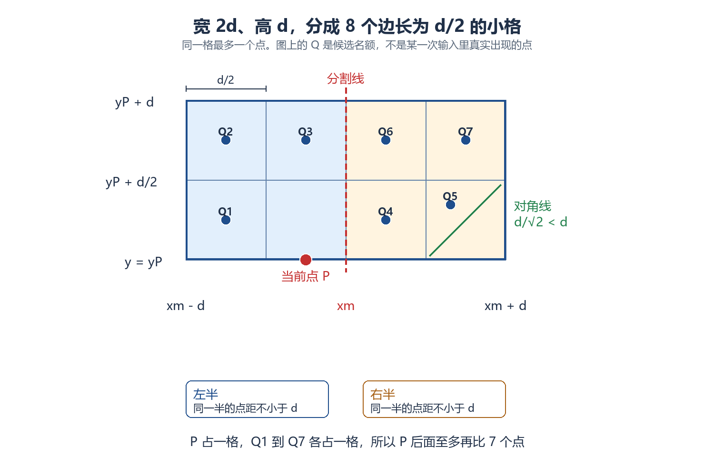

On October 30 I worked through Quoit Design from [this contest](https://vjudge.net/contest/862457#problem/A). The public statement is [HDU 1007](http://acm.hdu.edu.cn/showproblem.php?pid=1007). Every toy is a point, and the ring should be as large as possible without encircling two toys at once. I did not start by picking an algorithm. I asked what actually limits the radius.

A toy is encircled when its distance to the center is strictly less than the radius. If two points are less than \(2r\) apart, some circle of radius \(r\) contains both of them strictly: put the center at the midpoint. The radius can therefore be at most half the distance of the closest pair. If two toys coincide, the radius is 0. The output keeps two decimal places.

For \(P_i=(x_i,y_i)\) and \(P_j=(x_j,y_j)\), the Euclidean distance is

\[
d_{ij}=\sqrt{(x_i-x_j)^2+(y_i-y_j)^2}.
\]

Let \(d_{\min}\) be the minimum over all pairs. The answer is \(r=d_{\min}/2\).

While comparing pairs, I can compare squared distances, \((x_i-x_j)^2+(y_i-y_j)^2\). The square root is increasing on nonnegative numbers, so the pair with the smallest square is the closest pair. The square root and the division by 2 wait until the radius is printed.


{caption="The closest pair sets the radius. Across the cut, only a few points in the strip are compared"}

## Turn the Radius into the Closest Pair {#closest-pair}

After that reduction, the problem is the closest pair of points in the plane. \(N\) can be \(100000\), and the value to find is \(d_{\min}\).

A half with fewer than two points has no pair, so it does not enter the minimum. If a duplicate pair has already made the distance 0, the strip does not need to be searched.

## Why Checking Every Pair Is Not Enough {#brute-force}

My first idea was to measure every pair, each pair once:

```cpp
for (int i = 0; i < N; i++) {
    for (int j = i + 1; j < N; j++) {
        // update the minimum with the squared distance
    }
}
```

The time is \(O(N^2)\). At \(N=100000\), the number of pairs is

\[
\frac{N(N-1)}{2}=4999950000.
\]

That is nearly five billion comparisons. The distance formula is not the expensive part. The number of pairs is.

## Sorting and Pruning Do Not Change the Worst Case {#prune}

I then sorted the points by \(x\). Let \(d\) be the best distance so far. Once a later point \(P_j\) satisfies \(x_j-x_i\ge d\), its Euclidean distance from \(P_i\) is at least that large. Later points are even farther in \(x\), so the inner loop can stop.

This skips some comparisons. It does nothing when every point has the same \(x\) and the points differ only in \(y\): the \(x\) gap stays 0, and the worst case is still \(O(N^2)\).

**Doing fewer comparisons inside a loop is not the same as improving the worst-case bound.**

## The Halves Are Easy, and the Merge Cost Is the Hard Part {#across}

Pruning did not change the worst case. At \(N=100000\) I needed a way to reduce the number of pairs in the whole problem.

The points are already sorted by \(x\), so a cut down the middle leaves about half the points on each side. Each half asks the same question: how close is the closest pair inside this half? The question is unchanged and the size is smaller, so the same procedure can run recursively. The closest distance on the left and the closest distance on the right both come straight out of that recursion. Each half's \(d_{\min}\) is the easy part.

What is still open is the cost of putting the two halves together. Take the smaller of the two results:

\[
d=\min(d_L,d_R).
\]

That only constrains pairs inside one half: points on the left are at least \(d\) apart, and so are points on the right. One point on the left and one point on the right can still be closer, so the answer cannot stop at this \(d\). The merge still has to handle pairs that cross the cut.

That merge cost is the hard part. If every left point is compared with every right point, one level is \(O(N^2)\), and splitting the set has not removed any work. The rest of the argument is about how many crossing pairs still have to be checked once \(d\) is known, and whether that level can be brought down to \(O(N)\).

## Only the Strip Near the Cut Matters {#strip}

Let the cut be \(x=x_m\). If a pair is closer than \(d\), its \(x\) gap is also less than \(d\), because \(|x_i-x_j|\le d_{ij}\). A crossing pair that might update the answer has to lie in the vertical strip

\[
|x-x_m|<d.
\]

The strip has width \(2d\).

The strip can still hold many points. Scan them by increasing \(y\). For a fixed point \(P\), a later point \(Q\) with \(y_Q-y_P\ge d\) cannot be closer than \(d\), and neither can any point after it. A candidate \(Q\) must satisfy both

\[
\begin{cases}
|x_Q-x_m|<d,\\
0\le y_Q-y_P<d.
\end{cases}
\]

A candidate might be closer than \(d\). It is not already known to be closer.

## Why Each Point Has Only a Constant Number of Candidates {#cells}

This was the part that took the longest. The known fact is that pairs inside one half are at least \(d\) apart. Pairs across the cut are not known to be that far. If they were, the merge would be unnecessary. I cannot claim that every pair in the whole strip is at least \(d\).

For a fixed \(P\), take the rectangle from \(x_m-d\) to \(x_m+d\) and from \(y_P\) to \(y_P+d\). It is \(2d\) wide and \(d\) tall. Split it into 4 columns and 2 rows, eight squares of side \(d/2\). A cell's edge may lie on the cut, but its interior does not contain both halves: a point exactly on the cut was assigned to one half when the set was split.


{caption="P takes one cell, so at most seven candidates follow it. Two points in one cell would be less than d apart"}

Two points in the same cell are at most a diagonal apart:

\[
\sqrt{\left(\frac{d}{2}\right)^2+\left(\frac{d}{2}\right)^2}=\frac{d}{\sqrt{2}}<d.
\]

The chain is:

1. Two points in one cell are less than \(d\) apart.
2. That cell belongs entirely to one half.
3. Two points in the same half cannot be less than \(d\) apart.
4. Therefore one cell cannot contain two points.

Eight cells and one point per cell give at most eight points in the rectangle. One of them is \(P\), so at most seven candidates follow it. Each point is compared with a constant number of successors, not with every point in the strip.

**The cells do not directly limit distances across the cut. They prove that the number of candidates has a fixed upper bound.**

## The Rectangle Is Rebuilt for the Current Point {#rectangle}

I also asked whether \(P\) could only slide along the bottom edge of one fixed rectangle.

The strip is fixed by the cut and the current \(d\). The local rectangle is drawn separately for each current point. Scanning by increasing \(y\), a fixed \(P\) only needs later points, so the bottom edge is \(y=y_P\) and the top edge is \(y=y_P+d\). The next point gets a new bottom edge. \(P\) is not moving along one shared edge.

Scanning downward uses a rectangle that extends the other way. The direction is not the point. The sort is what lets points whose \(y\) gap is already at least \(d\) be skipped.

## How the Time Bound Becomes N log N {#complexity}

The whole procedure sorts by \(x\), splits into halves, finds \(d_L\) and \(d_R\), checks crossing pairs through the strip and the \(y\) order, and keeps the smaller distance. The radius is half of that distance.

Sorting again at every recursive level can cost \(O(N\log N)\) per level and \(O(N\log^2 N)\) overall. For \(O(N\log N)\), I can prepare an \(x\)-ordered sequence and a \(y\)-ordered sequence at the start. Each call splits the \(y\)-ordered sequence into the two halves, then merges those ordered sequences on the way back. The strip scan and the at most seven comparisons then run linearly in that order.

The merge at one level is \(O(N)\), so

\[
T(N)=2T\left(\frac{N}{2}\right)+O(N),
\]

and \(T(N)=O(N\log N)\). The initial \(x\) sort is the same order of growth and does not raise the bound.

## Review {#review}

I did not start from divide and conquer. Checking every pair is correct, and there are too many pairs. Stopping the inner loop after an \(x\) sort removes some work without changing the worst case. What divide and conquer adds is the distance \(d\) already found in the two halves: points far from the cut can be ignored, points whose \(y\) gap is at least \(d\) can be ignored, and each point has only a constant number of candidates left.

The sentence I want to keep is this: split the problem, then use the subproblem results to prove which pairs need not be checked. That is what makes the merge affordable.

> [!NOTE]
> Added on November 1: I later tried to turn this problem into a vibe-style explainer video. The models and the cost are in [An Attempt at a Vibe Knowledge Video](../vibe-quoit-video/).
