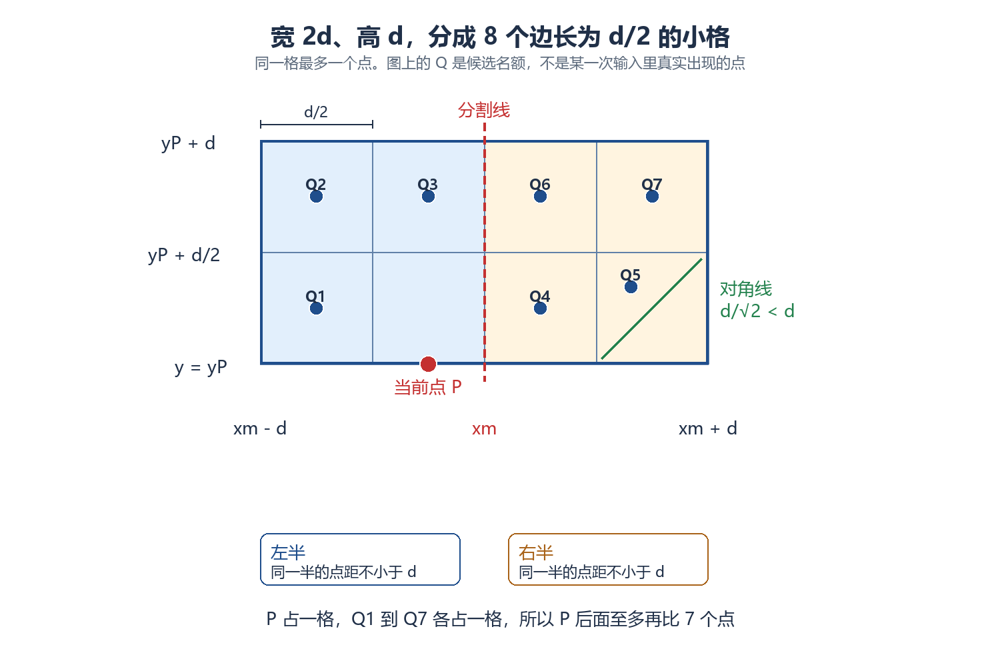

10 月 30 日我做的是 [这场比赛](https://vjudge.net/contest/862457#problem/A) 里的 Quoit Design。公开题面在 [HDU 1007](http://acm.hdu.edu.cn/showproblem.php?pid=1007)。场地上每个玩具是一个点，套圈要尽量大，但不能一次套中两个。我没有先挑算法，而是先问半径被什么卡住。

一个点被套中，是指它到圆心的距离严格小于半径。两个点的距离如果小于 \(2r\)，就存在一个半径为 \(r\) 的圆把它们同时严格套住，把圆心放在两点连线的中点上即可。因此半径最大只能到最近一对点的距离的一半。两点重合时，这个半径是 0。输出保留两位小数。

设 \(P_i=(x_i,y_i)\)、\(P_j=(x_j,y_j)\)，欧氏距离是

\[
d_{ij}=\sqrt{(x_i-x_j)^2+(y_i-y_j)^2}.
\]

所有点对里的最小距离记为 \(d_{\min}\)。答案是这个距离的一半。

比较谁更近时，可以先比距离的平方 \((x_i-x_j)^2+(y_i-y_j)^2\)。平方根在非负数上单调递增，平方最小的那一对就是距离最小的那一对。要输出半径时再开方、再除以 2。


{caption="最近点对决定半径，跨过分割线时只比条带里的少数点"}

## 先把半径收成最近点对 {#closest-pair}

这一步之后，题目就是平面最近点对。\(N\) 可以到 \(100000\)，要找的是 \(d_{\min}\)。

某一半不足两个点时，这一半没有点对，不拿去和另一半取最小。已经出现重合点、最小距离是 0 时，后面的条带也不必再查。

## 暴力枚举为什么不够 {#brute-force}

我最先想到的是把每对点都算一遍。同一对只算一次：

```cpp
for (int i = 0; i < N; i++) {
    for (int j = i + 1; j < N; j++) {
        // 用距离平方更新当前最小值
    }
}
```

时间是 \(O(N^2)\)。\(N=100000\) 时，点对个数是

\[
\frac{N(N-1)}{2}=4999950000.
\]

接近 50 亿次比较。慢不是因为距离公式难算，而是要看的点对太多。

## 排序剪枝改变不了最坏情况 {#prune}

我接着试过先按横坐标排序。设当前最小距离是 \(d\)。点已经从小到大排好。对前面的一个点来说，一旦后面某个点的横坐标差不小于 \(d\)，欧氏距离至少也有这么大，不可能更近。再往后差距只会更大，内层循环可以停。

这能跳过一部分比较。可是所有点的横坐标都相同、只是纵坐标不同时，横坐标差一直是 0，剪枝不会生效。最坏情况仍是 \(O(N^2)\)。

**少做几次循环里的比较，不等于把最坏情况的复杂度降下来。**

## 左右好求，难在合并的复杂度 {#across}

剪枝没有改变最坏情况。\(N\) 到了 \(100000\)，我需要一种能从整体上减少点对数量的办法。

点已经按横坐标排好，从中间切开，左右大约各一半。每一半要问的还是同一件事：这一半里面最近的两个点有多远。问题没变，只是规模变小，所以可以递归做下去。左半的最近距离、右半的最近距离，都由这个递归直接得到。两边各自的 \(d_{\min}\) 因此是好求的。

真正还没确定的是两边合在一起之后。先把两边的结果取较小的那个：

\[
d=\min(d_L,d_R).
\]

这只约束了同一半内部：左半任意两点都不小于 \(d\)，右半也一样。左边一个点和右边一个点仍可能更近，答案不能停在这个 \(d\) 上。合并时还要处理跨过分割线的点对。

难的就是这一步要花多少时间。合并时如果仍把左半每个点和右半每个点都比一遍，这一层就是 \(O(N^2)\)，切开再递归并没有少干活。后面要算清的是：手里已经有 \(d\) 之后，跨过分割线的点对还要看多少，这一层能不能压到 \(O(N)\)。

## 只检查条带里的点 {#strip}

设分割线是 \(x=x_m\)。一对点的距离若小于 \(d\)，横坐标差也必须小于 \(d\)，因为横坐标差不会大于欧氏距离。还想更新答案的跨区域点，都得落在

\[
|x-x_m|<d
\]

这条竖直条带里。条带宽 \(2d\)。

条带里仍可能有很多点。再按纵坐标从小到大看。固定当前点 \(P\)，后面的点 \(Q\) 若已经满足 \(y_Q-y_P\ge d\)，距离也不会小于 \(d\)，更后面的点可以停。\(Q\) 要成为候选，得同时满足

\[
\begin{cases}
|x_Q-x_m|<d,\\
0\le y_Q-y_P<d.
\end{cases}
\]

这里的候选是有可能比 \(d\) 更近，不是已经比 \(d\) 更近。

## 为什么每个点只比常数个候选 {#cells}

这一步我卡得最久。已知的是同一半内部的距离不小于 \(d\)，并不知道左右之间也都那么远。如果跨区域的距离已经不小于 \(d\)，合并阶段就不用查了。所以不能说整条条带里任意两点都不小于 \(d\)。

对固定的 \(P\)，看一个宽 \(2d\)、高 \(d\) 的矩形：从分割线向两侧各伸出 \(d\)，再从当前点的高度向上伸出 \(d\)。把它分成 4 列 2 行，共 8 个边长为 \(d/2\) 的小格。小格的边界可以贴着分割线，格子内部不会同时装进左右两半，因为分割线上的点在划分时已经归到其中一半。


{caption="P 占一格，后面至多还有 7 个候选；同一格里放进两个点，距离就会小于 d"}

同一个小格里两个点的距离，最大就是对角线

\[
\sqrt{\left(\frac{d}{2}\right)^2+\left(\frac{d}{2}\right)^2}=\frac{d}{\sqrt{2}}<d.
\]

推理是这四步：

1. 同一个小格里的两点，距离一定小于 \(d\)。
2. 这个小格完全属于同一半。
3. 同一半里的两点，距离不能小于 \(d\)。
4. 所以一个小格里不可能有两个点。

8 个小格，每格至多一个点，矩形里至多 8 个点。其中一个是正在看的 \(P\)，它后面至多还有 7 个候选。每个点只和常数个后继比较，不是和条带里的所有点比较。

**小格不是为了直接限制左右之间的距离，而是为了证明候选点的个数有一个固定上限。**

## 这个矩形是跟着当前点走的 {#rectangle}

我当时还问过：矩形以 \(P\) 为下边界，是不是 \(P\) 只能贴着同一条底边左右移动？

条带是固定的，由分割线和当前的 \(d\) 决定。局部矩形是每个当前点单独画的。点按纵坐标从小到大处理时，固定 \(P\) 之后只看排在它后面的点，所以下边界放在当前点的高度，上边界再向上一个 \(d\)。换到下一个点，下边界跟着换。\(P\) 不是在同一个矩形的底边上滑动。

反过来按纵坐标从大到小扫，就改用朝反方向伸出的矩形。方向不重要。重要的是排序之后，可以把纵坐标差已经不小于 \(d\) 的点排除掉。

## 怎样把复杂度收到 N log N {#complexity}

整个过程是：先按横坐标排序，分成左右两半，递归得到两半各自的最近距离，再用条带和纵坐标顺序检查跨区域点对，最后取更小的距离。半径是这个距离的一半。

如果每一层递归都把点重新排序，这一层就可能是 \(O(N\log N)\)，总时间会变成 \(O(N\log^2 N)\)。要收到 \(O(N\log N)\)，可以在最开始分别准备按横坐标、按纵坐标排好的序列。递归时按点属于左半还是右半，把已经按纵坐标排好的序列拆给两个子问题，返回后再按纵坐标合并。条带筛选和那至多 7 次比较就可以顺着这个顺序线性做完。

每一层的合并是 \(O(N)\)，递推是

\[
T(N)=2T\left(\frac{N}{2}\right)+O(N).
\]

因此 \(T(N)=O(N\log N)\)。一开始那一次横坐标排序也是这个量级，不会把上界再抬高。

## 小结复盘 {#review}

这道题我不是一开始就想到分治的。暴力枚举是对的，只是点对太多。按横坐标提前结束内层循环能剪掉一些，最坏情况还在。分治多出来的一步，是用左右两半已经求出的 \(d\) 当约束：离分割线太远的不用看，纵坐标差已经不小于 \(d\) 的不用看，每个点后面也只剩常数个候选。

我现在把分治记成一句：先拆开，再用子问题的结果证明哪些点对不必检查，合并才做得动。

> [!NOTE]
> 11 月 1 日补：我后来拿这道题试做了一条 vibe 知识视频，模型和花费另记在 [vibe 知识视频制作尝试](/blog/vibe-quoit-video/)。
