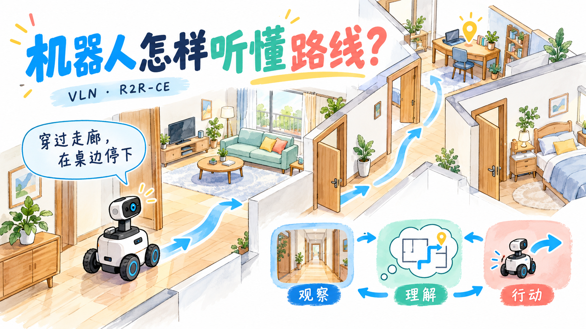
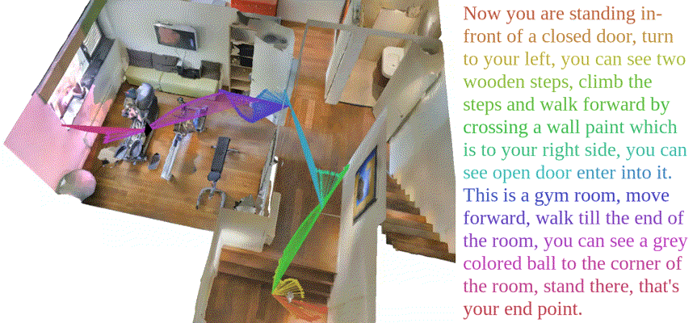
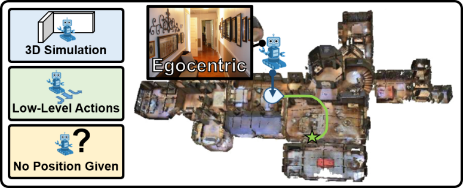

最近我在做一个 VLN 项目，用零样本方式调用成本相对可控的 `qwen3-vl-plus` API，在 R2R-CE 上进行语言导航。整理相关资料时，我主要关注几个问题：这些数据集分别提供什么，机器人在怎样的环境里移动，以及不同方法的成功率应该怎么看。

这篇记录我在 10 月 15 日整理的前置知识，末尾也补上了截至 10 月 17 日的方法调研。我先把场景、任务和仿真平台分开，再顺着它们看导航方式、评测指标和论文结果。

{caption="语言指令、当前观察和行动之间，需要形成一个不断更新的导航过程"}

## 零样本与经济 API {#project-start}

VLN 是 Vision-and-Language Navigation，也就是视觉语言导航。可以先理解成：机器人收到一段自然语言指令，结合自己看到的环境，判断下一步往哪里走，并在合适的位置停下。

比如“走出卧室，穿过走廊，在桌子旁边停下”，里面不只有一个终点。机器人还要辨认卧室、走廊和桌子，理解它们之间的关系，并判断指令执行到了哪一步。

我采用的是零样本路线：不使用 R2R-CE 的任务示范去训练或微调导航策略，而是借助已有视觉语言模型的能力来做决策。这里的“零样本”针对导航任务，基础模型本身已经经过预训练。

至于“经济 API”，我把它理解为项目的预算约束。除了成功率，也要看走完一条路线需要调用多少次、输入多少图像、消耗多少 token，以及等待多久。单次调用便宜，不一定代表整条路线也便宜。

## 场景、导航任务与仿真平台 {#three-layers}

我觉得刚接触这些名字时，最需要先分清三个层次。

**场景数据提供的是环境。** 比如 Matterport3D，简称 MP3D，里面有真实建筑扫描得到的图像、三维重建等数据。它先回答“房子长什么样”。

**导航任务数据提供的是要做的事。** 比如 R2R、RxR，会给出出发位置、语言指令、参考路线或目标，以及评测划分。它们回答“在这个房子里，要按什么要求走”。

**仿真平台负责让这个过程运行起来。** 比如 Matterport3D Simulator、Habitat，可以根据各自的环境表示执行动作、返回观察，让导航算法与环境交互。

因此，拿到三维场景不等于已经拿到了完整的 VLN 任务。一个基本的实验至少要把环境、任务定义和执行平台接起来。

### MP3D 与 HM3D {#scene-datasets}

[MP3D](https://niessner.github.io/Matterport/) 包含 90 个建筑级场景，提供 RGB-D 图像、相机位姿和三维重建等数据。R2R、RxR 这些经典导航任务建立在这批场景上，所以它对我当前项目的直接价值，是能沿用现成的任务标注和评测设置。

[HM3D](https://aihabitat.org/datasets/hm3d/) 则提供 1,000 个建筑级三维场景，能为具身导航提供更多环境。但它本身并不等于一整套带有人类路线指令的 VLN 数据。要拿这些环境做语言导航，还需要构建路线、指令和对应的任务定义。

两者都能用于 Habitat，但我不能只把 MP3D 换成 HM3D，就认为仍然是在做原来的 R2R-CE 评测。**场景更多，与任务是否相同，是两件事。**

## 几个常见 VLN 数据集 {#navigation-datasets}

这些名字的区别，主要需要回到任务设计上看。有些共享同一批建筑，但对机器人提出的要求不同。

### R2R：沿语言指令完成一段路线 {#r2r}

R2R 的全称是 Room-to-Room，是经典的室内 VLN 数据集。它基于 MP3D 场景，给一段路线配上人工英语指令，让智能体从起点走向目标。

[原始论文](https://arxiv.org/abs/1711.07280)中的 R2R 包含 7,189 条路线和 21,567 条指令，每条路线对应 3 条独立英语描述。这里的三条描述，是同一路线的不同表达，并不是连续执行的三个子任务。

原始 R2R 任务以导航图上的 viewpoint 为基础。理解这个环境表示，后面才能看清它和 R2R-CE 的区别。

### RxR：更丰富的路线与语言—视觉对齐 {#rxr}

RxR 的全称是 Room-Across-Room。它同样使用 MP3D 环境，但指令语言扩展到了英语、印地语和泰卢固语，路线也更长、更多样。

我觉得它值得单独记住的一点，是 dense spatiotemporal grounding，可以先理解为把语言、观察和移动过程做细粒度对齐。

数据采集时，指导者沿路线移动并描述周围环境，系统同时记录带时间信息的视角和位姿，再与指令中的词语对齐。因此，研究者不仅能看到最终路线，还能研究“说到这句话时，人看到了什么、朝着哪里”。这些是采集过程中的观察记录，不代表模型在测试时可以直接取得人的位姿轨迹。[RxR 官方说明](https://research.google/blog/rxr-a-multilingual-benchmark-for-navigation-instruction-following/)对这个过程有更直观的介绍。

{caption="RxR 的语言、观察与移动对齐示例"}

图片来源：[RxR 官方仓库的示例动画](https://github.com/google-research-datasets/RxR/blob/main/merged.gif)。

### R4R：到达终点与执行路线分开看 {#r4r}

R4R 的全称是 Room-for-Room。它通过连接 R2R 中符合条件的路线，并拼接相应指令，构造更长的导航任务。名字里的“4”不表示固定经过四个房间。

它让我注意到一个问题：**到达终点，与忠实执行指令，是两个需要分别衡量的能力。**

假设指令要求从大厅进入书房，穿过走廊，再进入卧室；但大厅恰好还有一扇门可以直接通向卧室。直接走近路也可能到达目标，却没有执行指令要求的完整过程。

因此，只看最终位置是不够的，还需要衡量实际走过的路线。这也是 [R4R 论文](https://aclanthology.org/P19-1181/)强调 instruction fidelity，也就是指令忠实度的原因。

### REVERIE：导航之外还要指认物体 {#reverie}

[REVERIE](https://arxiv.org/abs/1904.10151) 的任务又不一样。它使用高层语言描述，引导智能体到目标物体附近，并要求正确指认物体。

比如“去卧室，找到床头柜上的那盏灯”，重点不只是把路线走完。到了卧室以后，还需要明确到底是哪一个物体。

我先把这些区别记成：R2R 关注路线指令，RxR 增加多语言和细粒度对齐，R4R 强调长路线的指令忠实度，REVERIE 则把导航与物体指认放在一起。它们不宜只按名称相近就直接比较成功率。

## R2R 与 R2R-CE 的区别 {#discrete-continuous}

对我当前项目来说，最直接相关的区别还是 R2R 与 R2R-CE。

在原始 R2R 中，智能体在预先定义的全景观测位置之间移动。导航图的边已经说明哪些位置相互可达，算法主要选择下一步去哪个相邻 viewpoint。

R2R-CE 把这些语言导航任务迁移到连续三维环境中，通常通过 Habitat 运行。智能体需要实际执行移动与转向，在可通行区域内逐步改变位置，移动过程中也会遇到障碍和碰撞。

{caption="VLN-CE 的连续环境与底层移动动作"}

图片来源：[VLN-CE 官方项目页](https://jacobkrantz.github.io/vlnce/)。

### 连续环境不要求连续动作 {#continuous-actions}

这里面需注意，**连续环境不等于动作必须是连续值。**

[VLN-CE 的基础任务配置](https://github.com/jacobkrantz/VLN-CE/blob/master/habitat_extensions/config/vlnce_task.yaml)就可以使用固定距离的前进和固定角度的转向，例如前进 0.25 米、转向 15 度。动作选项是有限的，但智能体的运动不再限制在原始导航图的那几个观测节点上。

也可以采用另一种结构：上层先提出局部 waypoint，下层再设法移动过去。不过，“模型提出了一个点”不代表“这个点就一定能到”。候选点是否可达、途中怎样避障、失败后怎样反馈，仍然是系统的一部分。

这也让我更清楚地看到，VLN 项目需要把语言理解、视觉判断和实际移动接起来。换一个更强的 API，不能自动替代所有控制和通行判断。

## 导航结果应该怎样衡量 {#metrics}

我先把评测问题分成三件事：**到没到、走得是否高效、是否按指定路线走。**

### NE、SR 与 OSR：是否到达目标 {#arrival-metrics}

**NE** 是 Navigation Error，导航误差，通常衡量最终位置到目标的最短可通行距离，单位是米，越低越好。这里要沿环境里的可通行路径计算；隔着一堵墙的直线距离，并不能直接说明机器人离目标有多近。

**SR** 是 Success Rate，成功率。先按任务规则判断每个 episode 是否成功，再求整体比例。在常用 R2R-CE 设置中，需要在目标的成功距离内执行停止动作，距离阈值通常为 3 米。具体实现和是否计入 STOP，要看所用版本的评测代码。

**OSR** 是 Oracle Success Rate，关注整条轨迹是否曾经进入目标的成功范围。即使后来又走远了，这条轨迹也可能在 OSR 中算成功。[VLN-CE 的指标实现](https://github.com/jacobkrantz/VLN-CE/blob/master/habitat_extensions/measures.py)可以用来核对它的计算方式。

因此，OSR 较高而 SR 较低，说明有一些路线曾经到过目标附近，却没最终成功结束。这时可以检查停止判断、任务进度和后续移动，但不能只凭两个数字的差值就确定失败原因。

### SPL 与路径长度：是否走得高效 {#efficiency-metrics}

**SPL** 是 Success weighted by Path Length，结合了成功与路径效率。对一条任务来说，失败时得分为 0；成功时，再按最短路径长度与实际路径长度的比例折扣。

比如起点到目标的最短可通行路径是 10 米，实际走了 20 米后成功，那么这条任务的 SPL 得分是 0.5。最终再对所有任务取平均。[SPL 的评测论文](https://arxiv.org/abs/1807.06757)给出了正式定义。

**TL / PL** 通常表示实际轨迹或路径长度，单位也是米。这个数字要结合成功率看：走得很短，可能是路线高效，也可能是智能体很早就停错了。

SPL 中用作参照的是起终点之间的最短路径长度，不能总把它等同于指令要求的完整路线长度。因此，SPL 也不能单独代表是否忠实执行了整段指令。

### nDTW：是否沿着参考路线走 {#path-fidelity}

如果要检查实际路线与参考路线的相似程度，还可以看 **nDTW**。它通过动态时间规整对齐轨迹，衡量两条路线是否接近，而不只看最后的终点。[nDTW 论文](https://arxiv.org/abs/1907.05446)讨论了这类指令导航评测。

前面 R4R 的例子里，直接从大厅抄近路进入卧室，可能到达了终点，但对参考路线的忠实程度就不一样。到这里，我才觉得“到达目标”和“执行路线”应该分开看这句话更具体了。

## 不同路线的成功率调研 {#comparing-results}

看论文的实验表时，我会先看方法属于哪条路线，再看它测了哪些任务。下面保留了几个常见的比较条件：

- 是原始 R2R，还是连续环境中的 R2R-CE？
- 是 `val_seen`、`val_unseen`，还是测试集？跑的是完整划分还是一个子集？
- 模型看到了 RGB、深度、位姿中的哪些信息？能不能获取全景观察？
- 系统有没有训练过的导航策略、waypoint 预测器或其他模块？是否允许提前探索环境？
- 用的是哪一个模型版本？每条任务调用多少次、耗时多久、花费多少？

“是否训练”“基础模型如何部署”“使用什么额外模块”是不同维度。比如一个方法可以不微调主模型，同时调用 API 和预训练的感知模块。我按这些区别整理了几类代表结果，用来理解目前不同路线大致做到了什么程度。

### 截至 10 月 17 日的代表结果 {#literature-update}

**1. 零样本小模型：约 30%。**

[LightZeroNav](https://arxiv.org/html/2603.16947v2) 使用 Qwen3-VL-8B，在 R2R-CE 的 **100 条任务子集** 上报告的 SR 为 **30.0% ± 2.0%**；4B 版本为 **27.0% ± 3.0%**。它没有针对导航任务进行微调，而是通过任务分解、观察筛选和进度判断来组织执行。这是我笔记中“小模型约 30%”的具体参照。

**2. 零样本开放大模型或经济 API：有约 40%–50% 的代表结果。**

[SpaceVLN](https://arxiv.org/html/2606.08992v1#A3.SS3) 在 R2R-CE `val_unseen` 上评测了 **1,839 条任务**。其中，`Qwen3-VL-Plus + Qwen3-VL-Flash` 配置的 SR 为 **40.3%**，本地 Qwen3.5 配置为 **48.9%**。Plus 与 Flash 分别承担规划和执行，系统还结合 RGB-D、位姿和空间记忆。对我使用经济 API 的项目来说，这组结果比较直接相关。

**3. 训练过的导航模型：完整评测划分上有约 70%–80% 的代表结果。**

[Qwen-RobotNav-8B](https://github.com/QwenLM/Qwen-RobotNav) 在 R2R-CE `val_unseen` 上报告 **72.1%** SR；[Robostral Navigate](https://mistral.ai/news/robostral-navigate/) 报告 **76.6%**，后者是一个经过导航训练、使用单目 RGB 输入的 8B 模型。这一类把导航能力更多地训练进模型参数，与直接调用通用模型的零样本路线不同。

**4. 零样本加旗舰 API：部分 100 条子集结果已接近 80%。**

[GPT-6-Astra 的零样本导航评测](https://arxiv.org/html/2609.29861v1)在 R2R-CE 的 **100 条任务子集** 上，使用单目 RGB 和底层动作，medium 推理配置达到 **76.0%** SR，ultra 配置达到 **79.0%**。这里除了模型本身，也涉及推理预算：同一个模型切换推理配置，结果就会变化。

**5. 旗舰模型与训练模块结合的混合系统：完整评测划分上已有约 80% 的结果。**

[NavGPT-3 预印本的表 6](https://arxiv.org/html/2610.10787v1#S4.T6)给出了这条路线的代表结果。在 R2R-CE **完整 `val_unseen` 划分** 上，GPT-6 Astra 与 8B NavGPT VLA 结合的配置达到 **81.51%** SR、**70.42%** SPL；Claude Opus 5 配置的 SR 为 **79.01%**。作为对照，单独运行 8B NavGPT VLA 的 SR 为 **74.51%**。

我把它归到混合系统，是因为它同时使用旗舰语言模型的推理能力和训练过的导航策略：上层模型负责理解指令、规划和检查执行情况，NavGPT VLA 负责更高频的动作执行，系统还提供地图、回退等工具。这里比较的不只是模型大小，也包括这些能力怎样配合起来。

我关心这些结果，不只是为了找一个最高的成功率，也是想理解：模型能力、观察方式和导航模块分别起了什么作用。对于“零样本 + 经济 API”这条路线，成功率之外，走完一条任务需要花多少成本，也是比较方法时绕不开的问题。
