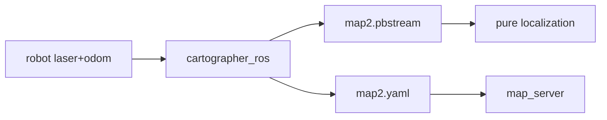

## Match maps {#maps}

| File | Role |
| ---- | ---- |
| `data/maps/map2.yaml` | Occupancy grid for `map_server` |
| `data/maps/map2.pbstream` | Cartographer pure localization |

Both files must come from the same mapping run. **After replacing the map, remeasure the waypoints** ([`nav_competition.yaml`](https://github.com/RyanYhy/raicom2026/blob/main/src/raicom2026/param/nav_competition.yaml)).

## Toolchain {#toolchain}

The mapper itself is the **external** workspace `~/cartographer_ws`. This repository provides:

| Location | Contents |
| ---- | ---- |
| `config/cartographer/` | Lua configuration |
| `scripts/save_map.sh` | Save yaml and pgm |
| `scripts/save_pbstream.sh` | Save pbstream |
| `test/launch/cartographer_localization.launch` | Debug pure localization |

## Mapping steps {#pipeline}

1. Map the field online with Cartographer
1. Save pbstream and yaml
1. Copy them into `raicom2026/data/maps/`
1. Mark waypoints with `mark_waypoint*.py`
{.steps}

## How the match launch uses the map {#launch}

[`nav_competition_2026.launch`](https://github.com/RyanYhy/raicom2026/blob/main/src/raicom2026/launch/nav_competition_2026.launch) defaults to:

- `map` → `map2.yaml`
- `pbstream` → `map2.pbstream`
- With `loc_mode:=cartographer`, `cartographer_node` loads the pbstream
