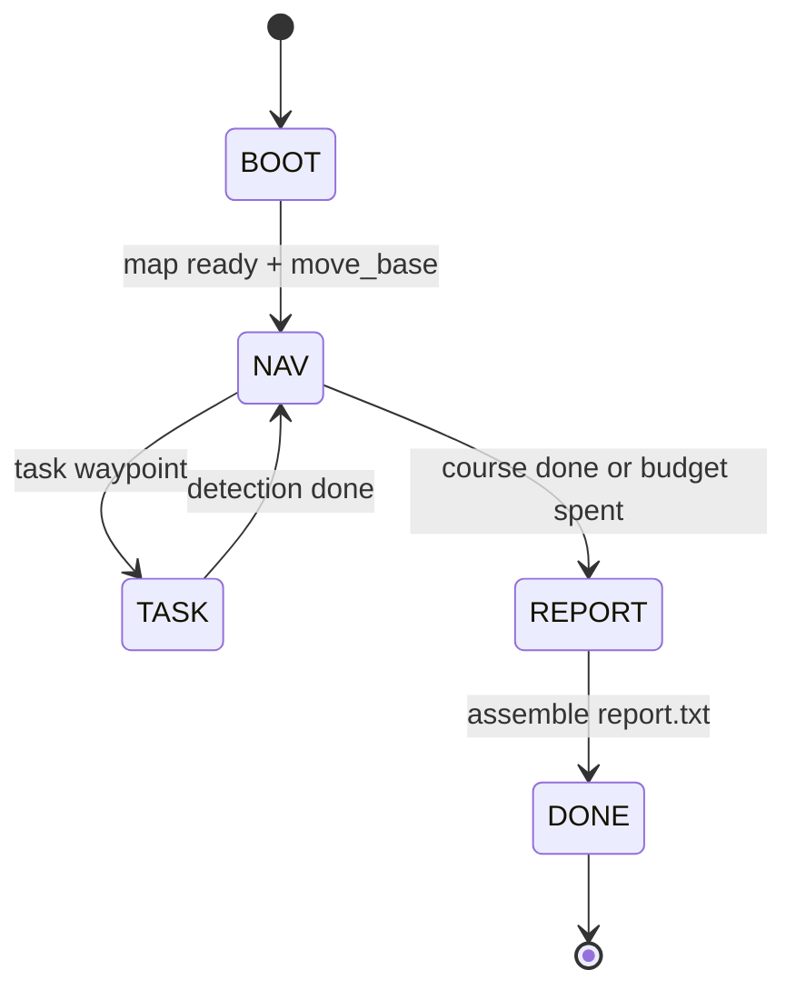

Vehicle ROS software for the RAICOM Intelligent Reconnaissance event. Within five minutes the robot crosses zones A–D, recognizes people and fires water pellets, counts mines, detects anti-tank obstacles and avoids them, then writes a byte-exact **6-line** `report.txt`.

- **Platform**: ROS Melodic · Ubuntu 18.04 · catkin workspace `1raicom_ws`
- **Repository**: [raicom2026](https://github.com/RyanYhy/raicom2026)

## What the system does {#mission}

The match is three pipelines:

1. **Navigation** — cruise the preset waypoints (`move_base` + Cartographer)
1. **Perception** — at a task waypoint, run vision (people / mines / anti-tank)
1. **Output** — each task writes a partial report, then the parts merge into a 6-line `report.txt`
{.steps}

Startup has two stages. **prep** brings up every sensor and model. After the referee starts the clock, **go** starts only the navigation orchestrator, so the robot can leave within seconds.

{caption="Layers from hardware up to the match tasks"}

## Layers {#layers}

| Layer | Contents | Main location |
| ---- | ---- | ---- |
| M1 Hardware | Mecanum chassis, IMU, 2D lidar, gimbal gun, webcam, Orbbec | `config/udev/` |
| M2 Drivers | Serial, lidar, and camera drivers, odometry | `chassis_driver`, `imu_driver`, `leishen/`, `orbbec_camera` |
| M3 Fusion | EKF: `odom_raw` + IMU → `/odom` | `robot_localization` |
| M4 Model | URDF and static TF | `robot_description` |
| M5 Localization and navigation | Map, Cartographer, `move_base` | `raicom2026/launch/`, `robot_navigation/` |
| M6 Match tasks | Navigation orchestration, vision, report | `raicom2026/scripts/` |
| M7 Operations | prep/go and calibration tools | `scripts/`, `test/` |

## Data flow {#dataflow}

{caption="Sensors to fusion, localization, planning, and the chassis. Navigation calls vision through services."}

**Sensors → fusion → localization → planning → chassis**

- Lidar `/scan`, IMU, and `odom_raw` pass through the EKF to produce `/odom`
- Cartographer publishes `map → odom`
- `move_base` outputs `/move_base/cmd_vel` → `cmd_vel_merge` → `/cmd_vel` → chassis

**Task triggers** are services, not continuous topics. `nav_competition.py` calls `/person_detect_service`, `/mine_detect_service`, and `/antitank_check_service`.

## Two cameras {#cameras}

| Camera | Mount | Model | Task |
| ---- | ---- | ---- | ---- |
| Gimbal webcam | Turns with the servos | `person.onnx` | Person detection and water-pellet shooting in zones A–D |
| Gimbal webcam | Same mount | `mine.onnx` | Mine counting in zones A/B |
| Orbbec DCW2 | Fixed on the nose | `antitank.onnx` | Anti-tank detection, then costmap avoidance |

## prep / go {#prep-go}

| Stage | Command | What it does |
| ---- | ---- | ---- |
| prep | `start_match_prep.sh` | Background main launch: sensors, models, localization, move_base |
| go | `start_match_go.sh` | Clear reports and start only `nav_competition.py` |

See [Usage](../usage/).

## Runtime state {#nav-state}

State topic: `/nav_competition/state` (for example `NAV:P3`, `TASK:人物A`).

## Related pages {#related}

- [Usage](../usage/)
- [Match tasks](../module-tasks/)
- [Appendix](../appendix/)
