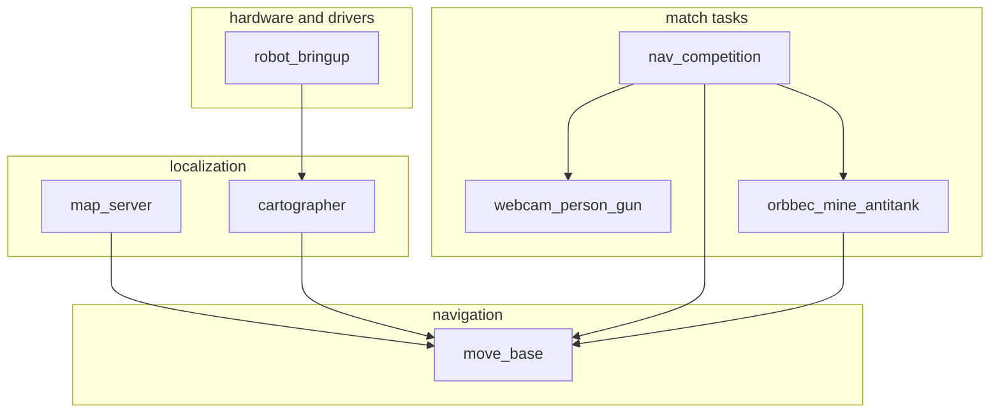

## Dependencies {#deps}

## Where to change things {#dev-tips}

| Goal | Change |
| ---- | ---- |
| Waypoints or timeouts | Only `nav_competition.yaml` |
| Recognition | The matching `scripts/*.py` plus `data/models/*.onnx` |
| Navigation | `robot_navigation/param/` and the launch files |
| A new feature | **Prefer the `raicom2026` package** |

> [!TIP] Site and repository
> This site organizes the notes with [Oink](https://oink.pgsty.com/zh/book/). Code changes belong in the [GitHub repository](https://github.com/RyanYhy/raicom2026). The file index is in the [appendix](../appendix/).

## Entry points {#entry}

| Use | Path |
| ---- | ---- |
| Environment | `scripts/setup_env.sh` |
| prep/go | `scripts/start_match_*.sh` |
| Main launch | `launch/nav_competition_2026.launch` |
